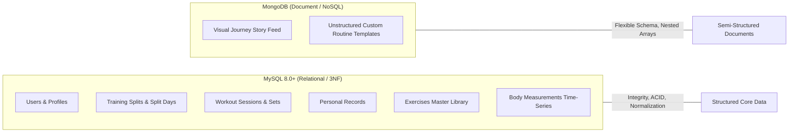
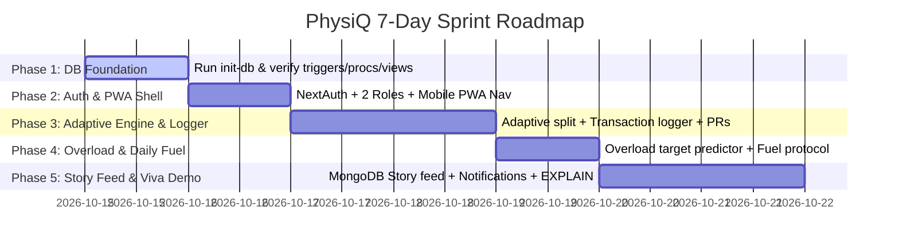

# PhysiQ — Master Project Plan & DBMS Technical Blueprint

> **Course:** DBMS Level 3 Project &bull; **Institution:** PES University &bull; **Instructor:** Dr. Nagasundari S  
> **Core Concept:** A Database-Driven Personal Fitness Management & Adaptive Progressive Overload System  
> **Architecture:** Mobile-First Responsive PWA (Next.js 14) + Polyglot Persistence (MySQL 8.0+ & MongoDB)  
> **Closed Feedback Loop:** `PLAN → TRAIN → RECORD → ANALYZE → ADAPT → TRAIN AGAIN`

---

## 1. Project Overview & Problem Statement

Gym-goers frequently track workouts, training splits, and body changes across fragmented apps or paper notebooks. When a scheduled workout is missed, conventional calendar-based apps (e.g. *Monday = Push, Tuesday = Pull*) desync completely.

**PhysiQ** solves this with a **database-centric architecture**:
1. **Adaptive Scheduling:** Queries actual relational workout history in MySQL to determine which muscle group is most overdue, considering recovery intervals.
2. **Automated Progressive Overload:** Tracks personal records (PRs) per exercise and prescribes gradual, data-driven weight/rep targets via stored procedures.
3. **Streamlined Daily Fuel & Recovery:** Replaces cumbersome food weighing with dynamic, formula-driven protein and hydration targets calculated directly from user body measurements and goals.
4. **Visual Journey Feed (NoSQL):** Implements a chronological timeline feed in MongoDB for progress photos, mood, and tags without fragile image comparison algorithms.

---

## 2. PESU DBMS Level 3 Requirements Compliance Matrix

| Syllabus Requirement | PhysiQ Implementation | File / Technical Artifact |
|---|---|---|
| **SQL Database (Mandatory)** | MySQL 8.0+ relational schema in 3NF | [`database/schema.sql`](file:///database/schema.sql) |
| **NoSQL Database (Mandatory Option 1)** | MongoDB for flexible custom workout templates & visual journey stories | [`src/lib/mongodb.ts`](file:///src/lib/mongodb.ts), collection: `journey_stories` |
| **Relational Normalization** | Strict 3NF (zero transitive dependencies, atomic fields, foreign key integrity) | [`docs/DATABASE_DESIGN.md`](file:///docs/DATABASE_DESIGN.md) |
| **Role-Based Access (Min 2 Roles)** | `member` (personal tracking) and `admin` (master library management) | `users.role ENUM('member', 'admin')` |
| **Advanced SQL Concept 1: Transactions** | Multi-table atomic workout logging (session header + sets + volume + PRs) | [`src/app/api/workouts/route.ts`](file:///src/app/api/workouts/route.ts) |
| **Advanced SQL Concept 2: Triggers** | Auto-updates `split_days.last_trained_date` and real-time session volume recalculation | [`database/triggers.sql`](file:///database/triggers.sql) |
| **Advanced SQL Concept 3: Stored Procs & Functions** | `sp_get_next_body_part`, `sp_estimate_next_target`, `sp_check_and_update_pr`, `fn_calculate_1rm`, `fn_get_daily_fuel_targets` | [`database/procedures.sql`](file:///database/procedures.sql) |
| **Advanced SQL Concept 4: Views** | `view_weekly_muscle_volume`, `view_personal_records_detailed` | [`database/views.sql`](file:///database/views.sql) |
| **Advanced SQL Concept 5: Indexing & EXPLAIN** | Composite B-Tree indexes with query execution plan proof (`type: range`) | [`database/indexes.sql`](file:///database/indexes.sql), [`docs/QUERY_PERFORMANCE_EXPLAIN.md`](file:///docs/QUERY_PERFORMANCE_EXPLAIN.md) |
| **Web Interface** | Next.js 14 App Router (Mobile-First PWA) | [`src/app/`](file:///src/app/) |
| **Security & Validation** | Bcrypt password hashing, check constraints, prepared statements | Prevents SQL injection & plaintext leak |

---

## 3. Polyglot Persistence Justification (SQL vs NoSQL)

When defending the database choice during the evaluation viva:



* **Why MySQL for Core Data?**  
  Workouts, sets, personal records, and user splits are **relational, transactional, and strictly structured**. Atomicity matters: saving a workout while sets fail corrupts user history. 3NF ensures no redundant data duplication.
* **Why MongoDB for Journey Stories & Routines?**  
  Progress photos and custom routine templates carry **sparse, semi-structured attributes** (variable camera tags, custom notes, superset arrays, mood ratings). Modeling these in SQL leads to wide, sparsely populated tables full of `NULL` columns. MongoDB handles nested arrays and schema evolution naturally.

---

## 4. Streamlined Feature Architecture (Zero Bloat)

### Feature 1: Adaptive Overdue Scheduling
* **Mechanism:** Next.js invokes MySQL Stored Procedure `sp_get_next_body_part(user_id)`.
* **Logic:** Computes `DATEDIFF(CURRENT_DATE, last_trained_date)` across the user's active split days and identifies the muscle group that has gone longest without training while respecting recovery windows.
* **UI Output:** Dynamic Hero Card: *"Recommended Focus: **Pull (Back/Biceps)** — 6 days overdue"*.

### Feature 2: Workout Logger with ACID Transaction & Triggers
* **Mechanism:** Submits workout payload to `/api/workouts` running a `BEGIN ... COMMIT` block.
* **Step 1:** Inserts header into `workout_sessions`.
* **Step 2:** Loops through sets inserting into `sets`.
* **Step 3 (Trigger):** `trg_after_set_insert` calculates and adds set load (`weight * reps`) directly to `workout_sessions.total_volume`.
* **Step 4 (Trigger):** `trg_after_workout_session_insert` sets `split_days.last_trained_date = CURRENT_DATE`.
* **Step 5 (Stored Procedure):** `sp_check_and_update_pr` compares working sets against historical bests and updates `personal_records`.

### Feature 3: Gradual Progressive Overload Predictor
* **Mechanism:** Calls `sp_estimate_next_target(user_id, exercise_id)` before training.
* **Logic:**
  * If previous top set achieved $\ge 10$ reps $\longrightarrow$ Prescribe $+2.5\text{ kg}$ load at 8 reps.
  * If previous top set achieved $< 10$ reps $\longrightarrow$ Prescribe $+1\text{ rep}$ at the same load.
* **Estimated 1RM:** Displayed using deterministic SQL function `fn_calculate_1rm(weight, reps)`.

### Feature 4: Smart Daily Fuel & Recovery Protocol *(Zero-Bloat Nutrition)*
* **Mechanism:** Replaces tedious manual food searching with a formula-driven recovery protocol.
* **Logic (MySQL Stored Function `fn_get_daily_fuel_targets`):**
  * Protein Target: $\text{Current Weight} \times 2.0\text{g}$.
  * Water Target: $\text{Current Weight} \times 0.04\text{L}$.
  * Caloric Baseline: Auto-calculated based on user goal (`hypertrophy` = $+300$ kcal surplus, `fat loss` = $-400$ kcal deficit).
* **UI Output:** Daily fuel check-off widget (e.g. `[x] Hit 150g Protein`, `[ ] Drank 3.0L Water`).

### Feature 5: Visual Fitness Journey Feed *(MongoDB Document Model)*
* **Mechanism:** Chronological timeline cards organized by week/date.
* **Document Schema:**
  ```json
  {
    "user_id": 1,
    "date": "2026-10-15",
    "week_number": 4,
    "photo_url": "/uploads/week4_front.jpg",
    "weight_snapshot": 74.2,
    "caption": "Felt energized today, hit bench PR",
    "tags": ["morning", "fasted", "chest-day"]
  }
  ```

### Feature 6: Database-Driven Overdue Notifications
* **In-App Warning Banner:** Displays when `sp_get_next_body_part` detects any muscle group overdue by $\ge 4$ days.
* **PWA / Browser Push:** Standard HTML5 `Notification` API prompts the user on their phone/laptop:
  > *"🔔 PhysiQ Alert: Your Pull workout is 6 days overdue. Time to train today!"*

---

## 5. Relational Schema & Database Artifacts

### 10 Normalized MySQL Tables (3NF)
1. `users` (id, name, email, password_hash, role, goal, height, starting_weight, created_at)
2. `splits` (id, user_id, split_name, is_active, created_at)
3. `split_days` (id, split_id, body_part, day_order, last_trained_date)
4. `exercises` (id, name, muscle_group, equipment_needed, instructions)
5. `workout_sessions` (id, user_id, session_date, body_part, total_volume, notes)
6. `sets` (id, session_id, exercise_id, set_number, reps, weight, is_warmup, rpe)
7. `personal_records` (id, user_id, exercise_id, weight, reps, achieved_on)
8. `body_measurements` (id, user_id, weight, waist, chest, arms, recorded_on)
9. `admin_audit_logs` (id, admin_id, action, target_table, timestamp)
10. `user_daily_fuel` (id, user_id, date, protein_target, water_target, completed_protein, completed_water)

### Relational Views
* `view_weekly_muscle_volume`: Aggregates total completed sessions, workload volume, and muscle distribution per week.
* `view_personal_records_detailed`: Joins PRs with exercise metadata and calculated 1RM.

### Composite Indexes
* `idx_workout_sessions_user_date` ON `workout_sessions (user_id, session_date DESC)`
* `idx_sets_session_exercise` ON `sets (session_id, exercise_id)`
* `idx_body_measurements_user_date` ON `body_measurements (user_id, recorded_on DESC)`

---

## 6. Systematic 5-Phase Implementation Roadmap



### Phase 1: Database Foundation & Verification (Day 1)
- [ ] Connect MySQL server with `physiq_db`.
- [ ] Execute `schema.sql`, `triggers.sql`, `procedures.sql`, `views.sql`, `indexes.sql`.
- [ ] Load seed data: `seeds/exercises.sql` and `seeds/sample_history.sql`.
- [ ] Verify triggers and procedures in MySQL Workbench.

### Phase 2: Auth, Roles & Mobile-First PWA Shell (Day 2)
- [ ] NextAuth credentials login for `member` and `admin` roles.
- [ ] Implement mobile-first navigation bar and bottom app tab bar.
- [ ] Configure `manifest.json` for "Add to Home Screen" PWA installation.

### Phase 3: Adaptive Engine & Transactional Workout Logger (Days 3–4)
- [ ] Wire `/split` page to call `sp_get_next_body_part`.
- [ ] Wire `/workouts` logger to submit atomic MySQL transaction.
- [ ] Verify automatic volume calculation and PR detection in database tables.

### Phase 4: Progressive Overload & Smart Fuel Protocol (Day 5)
- [ ] Integrate `/progression` page with `sp_estimate_next_target` and `fn_calculate_1rm`.
- [ ] Build the "Daily Fuel & Recovery Target" card (protein, water, sleep check-offs).

### Phase 5: MongoDB Visual Story Feed, Notifications & Demo Script (Days 6–7)
- [ ] Connect MongoDB collection `journey_stories` for chronological fitness logs.
- [ ] Add Database-Driven Overdue Notification banner and HTML5 browser notifications.
- [ ] Run `EXPLAIN` query plan analysis comparing index range scans vs full table scans.
- [ ] Rehearse the 5-minute faculty demonstration workflow.

---

## 7. Step-by-Step 5-Minute Faculty Evaluation Script

| Time | Action on Screen | Database Feature to Announce & Explain |
|---|---|---|
| **0:00 - 1:00** | Log in as Member; view Home Dashboard | Explain **3NF Schema** & show **`sp_get_next_body_part`** calculating overdue focus based on historical `last_trained_date`. |
| **1:00 - 2:15** | Open Workout Logger; enter 3 sets of Bench Press with a heavy load; tap Submit | Explain **ACID Transaction**. Switch to MySQL Workbench to show **`total_volume` trigger** and **PR insertion trigger** firing in real time. |
| **2:15 - 3:00** | Open Target Overload Tab | Explain **Progressive Overload Procedure (`sp_estimate_next_target`)** and **1RM formula (`fn_calculate_1rm`)**. |
| **3:00 - 3:45** | Open Fitness Journey Story Feed | Explain **Polyglot Persistence Justification**: why MongoDB document modeling is ideal for semi-structured chronological photos and tags. |
| **3:45 - 4:15** | Show Overdue Notification Banner & Daily Fuel Card | Explain relational calculation of protein/water targets and history-driven alert triggers. |
| **4:15 - 5:00** | Switch to Terminal / MySQL Workbench | Run **`EXPLAIN SELECT ...`** to prove composite index seek (`idx_workout_sessions_user_date`) vs full table scan (`type: ALL`). |

---

## 8. GitHub Daily Commit & Collaboration Strategy

To guarantee a clean, active GitHub activity log for evaluator audits:
1. **Branch Protection:** All core features are developed and committed onto `the-DEMIGOD-iteration` branch before merging into `main`.
2. **Conventional Commits:** Every commit strictly uses conventional prefixes:
   * `feat(split): ...`
   * `feat(workouts): ...`
   * `feat(overload): ...`
   * `feat(nosql): ...`
   * `docs(viva): ...`
3. **Co-Authorship:** Both team members contribute daily commits covering database design and application logic to satisfy rubric Section 2 ("Each member must contribute to both database and application development").
