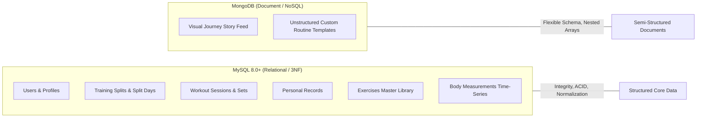
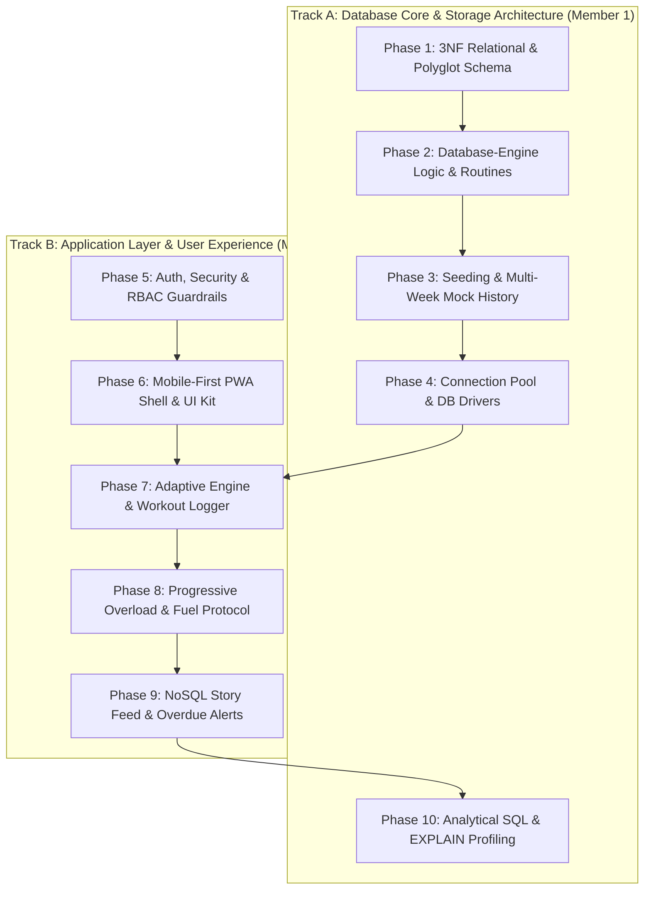

# PhysiQ — Master Project Plan & DBMS Technical Blueprint

> **Course:** DBMS Level 3 Project &bull; **Institution:** PES University &bull; **Instructor:** Dr. Nagasundari S  
> **Core Concept:** A Database-Driven Personal Fitness Management & Adaptive Progressive Overload System  
> **Architecture:** Mobile-First Responsive PWA (Next.js 14) + Polyglot Persistence (MySQL 8.0+ & MongoDB)  
> **Closed Feedback Loop:** `PLAN → TRAIN → RECORD → ANALYZE → ADAPT → TRAIN AGAIN`

---

## 1. Project Overview & Problem Statement

Gym-goers frequently track workouts, training splits, and body changes across fragmented apps or paper notebooks. When a scheduled workout is missed, conventional calendar-based apps (e.g. *Monday = Push, Tuesday = Pull*) desync completely.

**PhysiQ** solves this with a **database-centric architecture**:
1. **Adaptive Scheduling:** Queries actual relational workout history in MySQL to determine which muscle group is most overdue, considering recovery intervals.
2. **Automated Progressive Overload:** Tracks personal records (PRs) per exercise and prescribes gradual, data-driven weight/rep targets via stored procedures.
3. **Streamlined Daily Fuel & Recovery:** Replaces cumbersome food weighing with dynamic, formula-driven protein and hydration targets calculated directly from user body measurements and goals.
4. **Visual Journey Feed (NoSQL):** Implements a chronological timeline feed in MongoDB for progress photos, mood, and tags without fragile image comparison algorithms.

---

## 2. PESU DBMS Level 3 Requirements Compliance Matrix

| Syllabus Requirement | PhysiQ Implementation | File / Technical Artifact |
|---|---|---|
| **SQL Database (Mandatory)** | MySQL 8.0+ relational schema in 3NF | [`database/schema.sql`](file:///database/schema.sql) |
| **NoSQL Database (Mandatory Option 1)** | MongoDB for flexible custom workout templates & visual journey stories | [`src/lib/mongodb.ts`](file:///src/lib/mongodb.ts), collection: `journey_stories` |
| **Relational Normalization** | Strict 3NF (zero transitive dependencies, atomic fields, foreign key integrity) | [`docs/DATABASE_DESIGN.md`](file:///docs/DATABASE_DESIGN.md) |
| **Role-Based Access (Min 2 Roles)** | `member` (personal tracking) and `admin` (master library management) | `users.role ENUM('member', 'admin')` |
| **Advanced SQL Concept 1: Transactions** | Multi-table atomic workout logging (session header + sets + volume + PRs) | [`src/app/api/workouts/route.ts`](file:///src/app/api/workouts/route.ts) |
| **Advanced SQL Concept 2: Triggers** | Auto-updates `split_days.last_trained_date` and real-time session volume recalculation | [`database/triggers.sql`](file:///database/triggers.sql) |
| **Advanced SQL Concept 3: Stored Procs & Functions** | `sp_get_next_body_part`, `sp_estimate_next_target`, `sp_check_and_update_pr`, `fn_calculate_1rm`, `fn_get_daily_fuel_targets` | [`database/procedures.sql`](file:///database/procedures.sql) |
| **Advanced SQL Concept 4: Views** | `view_weekly_muscle_volume`, `view_personal_records_detailed` | [`database/views.sql`](file:///database/views.sql) |
| **Advanced SQL Concept 5: Indexing & EXPLAIN** | Composite B-Tree indexes with query execution plan proof (`type: range`) | [`database/indexes.sql`](file:///database/indexes.sql), [`docs/QUERY_PERFORMANCE_EXPLAIN.md`](file:///docs/QUERY_PERFORMANCE_EXPLAIN.md) |
| **Web Interface** | Next.js 14 App Router (Mobile-First PWA) | [`src/app/`](file:///src/app/) |
| **Security & Validation** | Bcrypt password hashing, check constraints, prepared statements | Prevents SQL injection & plaintext leak |

---

## 3. Polyglot Persistence Justification (SQL vs NoSQL)

When defending the database choice during the evaluation viva:



* **Why MySQL for Core Data?**  
  Workouts, sets, personal records, and user splits are **relational, transactional, and strictly structured**. Atomicity matters: saving a workout while sets fail corrupts user history. 3NF ensures no redundant data duplication.
* **Why MongoDB for Journey Stories & Routines?**  
  Progress photos and custom routine templates carry **sparse, semi-structured attributes** (variable camera tags, custom notes, superset arrays, mood ratings). Modeling these in SQL leads to wide, sparsely populated tables full of `NULL` columns. MongoDB handles nested arrays and schema evolution naturally.

---

## 4. Streamlined Feature Architecture (Zero Bloat)

### Feature 1: Adaptive Overdue Scheduling
* **Mechanism:** Next.js invokes MySQL Stored Procedure `sp_get_next_body_part(user_id)`.
* **Logic:** Computes `DATEDIFF(CURRENT_DATE, last_trained_date)` across the user's active split days and identifies the muscle group that has gone longest without training while respecting recovery windows.
* **UI Output:** Dynamic Hero Card: *"Recommended Focus: **Pull (Back/Biceps)** — 6 days overdue"*.

### Feature 2: Workout Logger with ACID Transaction & Triggers
* **Mechanism:** Submits workout payload to `/api/workouts` running a `BEGIN ... COMMIT` block.
* **Step 1:** Inserts header into `workout_sessions`.
* **Step 2:** Loops through sets inserting into `sets`.
* **Step 3 (Trigger):** `trg_after_set_insert` calculates and adds set load (`weight * reps`) directly to `workout_sessions.total_volume`.
* **Step 4 (Trigger):** `trg_after_workout_session_insert` sets `split_days.last_trained_date = CURRENT_DATE`.
* **Step 5 (Stored Procedure):** `sp_check_and_update_pr` compares working sets against historical bests and updates `personal_records`.

### Feature 3: Gradual Progressive Overload Predictor
* **Mechanism:** Calls `sp_estimate_next_target(user_id, exercise_id)` before training.
* **Logic:**
  * If previous top set achieved $\ge 10$ reps $\longrightarrow$ Prescribe $+2.5\text{ kg}$ load at 8 reps.
  * If previous top set achieved $< 10$ reps $\longrightarrow$ Prescribe $+1\text{ rep}$ at the same load.
* **Estimated 1RM:** Displayed using deterministic SQL function `fn_calculate_1rm(weight, reps)`.

### Feature 4: Smart Daily Fuel & Recovery Protocol *(Zero-Bloat Nutrition)*
* **Mechanism:** Replaces tedious manual food searching with a formula-driven recovery protocol.
* **Logic (MySQL Stored Function `fn_get_daily_fuel_targets`):**
  * Protein Target: $\text{Current Weight} \times 2.0\text{g}$.
  * Water Target: $\text{Current Weight} \times 0.04\text{L}$.
  * Caloric Baseline: Auto-calculated based on user goal (`hypertrophy` = $+300$ kcal surplus, `fat loss` = $-400$ kcal deficit).
* **UI Output:** Daily fuel check-off widget (e.g. `[x] Hit 150g Protein`, `[ ] Drank 3.0L Water`).

### Feature 5: Visual Fitness Journey Feed *(MongoDB Document Model)*
* **Mechanism:** Chronological timeline cards organized by week/date.
* **Document Schema:**
  ```json
  {
    "user_id": 1,
    "date": "2026-10-15",
    "week_number": 4,
    "photo_url": "/uploads/week4_front.jpg",
    "weight_snapshot": 74.2,
    "caption": "Felt energized today, hit bench PR",
    "tags": ["morning", "fasted", "chest-day"]
  }
  ```

### Feature 6: Database-Driven Overdue Notifications
* **In-App Warning Banner:** Displays when `sp_get_next_body_part` detects any muscle group overdue by $\ge 4$ days.
* **PWA / Browser Push:** Standard HTML5 `Notification` API prompts the user on their phone/laptop:
  > *"🔔 PhysiQ Alert: Your Pull workout is 6 days overdue. Time to train today!"*

---

## 5. Relational Schema & Database Artifacts

### 10 Normalized MySQL Tables (3NF)
1. `users` (id, name, email, password_hash, role, goal, height, starting_weight, created_at)
2. `splits` (id, user_id, split_name, is_active, created_at)
3. `split_days` (id, split_id, body_part, day_order, last_trained_date)
4. `exercises` (id, name, muscle_group, equipment_needed, instructions)
5. `workout_sessions` (id, user_id, session_date, body_part, total_volume, notes)
6. `sets` (id, session_id, exercise_id, set_number, reps, weight, is_warmup, rpe)
7. `personal_records` (id, user_id, exercise_id, weight, reps, achieved_on)
8. `body_measurements` (id, user_id, weight, waist, chest, arms, recorded_on)
9. `admin_audit_logs` (id, admin_id, action, target_table, timestamp)
10. `user_daily_fuel` (id, user_id, date, protein_target, water_target, completed_protein, completed_water)

### Relational Views
* `view_weekly_muscle_volume`: Aggregates total completed sessions, workload volume, and muscle distribution per week.
* `view_personal_records_detailed`: Joins PRs with exercise metadata and calculated 1RM.

### Composite Indexes
* `idx_workout_sessions_user_date` ON `workout_sessions (user_id, session_date DESC)`
* `idx_sets_session_exercise` ON `sets (session_id, exercise_id)`
* `idx_body_measurements_user_date` ON `body_measurements (user_id, recorded_on DESC)`

---

## 6. Highly Granular 10-Phase Nested Roadmap & Work Distribution

This distributed breakdown allows for **daily commits**, clean **Git contribution graphing**, and strict division of responsibilities across both partners as mandated by Dr. Nagasundari S.



---

### Phase 1: Relational Architecture, 3NF Modeling & Polyglot Schema
*Focus: Establishing clean database constraints, foreign key cascades, and document validators.*
* **Subphase 1.1: MySQL Core DDL Implementation**
  * Define `users`, `splits`, `split_days`, `exercises`, `workout_sessions`, `sets`, `personal_records`, `body_measurements`.
  * Add explicit constraints: `CHECK (reps > 0)`, `CHECK (weight >= 0)`, `UNIQUE (email)`, `UNIQUE (exercise_name)`.
  * Commit tag: `feat(db): implement 3NF MySQL relational DDL`
* **Subphase 1.2: MongoDB Document Validator & Modeling**
  * Write JSON Schema validator for `journey_stories` (flexible tags, mood, photo URL, date).
  * Write JSON Schema validator for `custom_routines` (nested superset arrays).
  * Commit tag: `feat(nosql): define MongoDB collection validation schemas`
* **Subphase 1.3: Data Dictionary & Normalization Documentation**
  * Formalize functional dependency proofs proving 1NF, 2NF, and 3NF compliance.
  * Generate complete data dictionary tables with types, nullability, and foreign key actions.
  * Commit tag: `docs(db): generate 3NF normalization proof & data dictionary`

---

### Phase 2: Database-Engine Server-Side Logic (Triggers, Routines & Views)
*Focus: Enforcing business logic inside the database engine rather than application code.*
* **Subphase 2.1: Automated State & Volume Triggers**
  * Implement `trg_after_workout_session_insert`: synchronizes `split_days.last_trained_date`.
  * Implement `trg_after_set_insert`, `trg_after_set_update`, `trg_after_set_delete`: atomic session volume calculator.
  * Commit tag: `feat(triggers): add last_trained_date sync and volume calculation triggers`
* **Subphase 2.2: Adaptive Scheduling & Overload Stored Procedures**
  * Implement `sp_get_next_body_part`: adaptive overdue algorithm with priority ordering.
  * Implement `sp_estimate_next_target`: progressive overload weight/rep predictor.
  * Implement `sp_check_and_update_pr`: automated personal record detection.
  * Commit tag: `feat(procedures): implement adaptive scheduler and PR detection procedures`
* **Subphase 2.3: Stored Functions & Relational Views**
  * Implement deterministic function `fn_calculate_1rm(weight, reps)` (Epley formula).
  * Implement function `fn_get_daily_fuel_targets(weight, goal)` (calculates protein & water requirements).
  * Create view `view_weekly_muscle_volume` and `view_personal_records_detailed`.
  * Commit tag: `feat(views): create analytical views and mathematical 1RM function`
* **Subphase 2.4: Composite B-Tree Indexing Strategy**
  * Create `idx_workout_sessions_user_date (user_id, session_date DESC)`.
  * Create `idx_sets_session_exercise (session_id, exercise_id)`.
  * Create `idx_body_measurements_user_date (user_id, recorded_on DESC)`.
  * Commit tag: `feat(indexes): add composite performance indexes for history queries`

---

### Phase 3: Seeding & Realistic Telemetry Generation
*Focus: Supplying realistic data so all procedures, views, and dashboards are immediately verifiable.*
* **Subphase 3.1: Master Exercise Library Seeding**
  * Seed 30 core compound and isolation movements categorized by Chest, Back, Shoulders, Quads, Hamstrings, Arms, Core.
  * Commit tag: `seed(exercises): populate master exercises library across all muscle groups`
* **Subphase 3.2: Multi-Week Realistic Workout History Seeding**
  * Seed 3+ weeks of sessions, working sets, PR milestones, and measurement changes for test user `alex@physiq.test`.
  * Commit tag: `seed(history): populate 3-week progressive training history and PR milestones`
* **Subphase 3.3: Automated Database Migration & Init Runner**
  * Build and verify `scripts/init-db.js` running all DDL, triggers, procs, views, and seeds in sequential dependency order.
  * Commit tag: `feat(scripts): build automated multi-file database initialization runner`

---

### Phase 4: Full-Stack Database Driver & Connection Layer
*Focus: Safe connection pooling, transactional helper wrappers, and fail-safe error handling.*
* **Subphase 4.1: MySQL Connection Pool & Transaction Wrapper**
  * Configure `mysql2/promise` connection pool with keep-alive, connection limits, and error recovery.
  * Build `executeTransaction()` utility handling automatic `BEGIN`, `COMMIT`, and `ROLLBACK`.
  * Commit tag: `feat(lib): configure resilient MySQL connection pool and transaction helper`
* **Subphase 4.2: MongoDB Client Driver & Singleton Connection**
  * Build singleton MongoDB client wrapper in `src/lib/mongodb.ts`.
  * Ensure connection reuse during Next.js hot-reload development cycles.
  * Commit tag: `feat(lib): configure MongoDB client connection singleton`
* **Subphase 4.3: Health Check & Connection Telemetry API**
  * Implement `/api/health` returning live table counts, connection statuses, and driver latencies.
  * Commit tag: `feat(api): build database health check and diagnostics endpoint`

---

### Phase 5: Authentication, Security & Role-Based Access Control (RBAC)
*Focus: Rubric compliance for user authentication and minimum 2 roles (`member` and `admin`).*
* **Subphase 5.1: Password Security & User Registration Endpoint**
  * Implement `/api/auth/register` with 10-round bcrypt password hashing and email uniqueness constraints.
  * Commit tag: `feat(auth): implement secure registration with bcrypt credential hashing`
* **Subphase 5.2: Role Segregation & Admin Guards**
  * Configure NextAuth credentials provider attaching `role` (`member` | `admin`) to the session token.
  * Build role-guard middleware restricting master exercise catalog mutations to `admin`.
  * Commit tag: `feat(auth): add role-based access control guards for member and admin roles`
* **Subphase 5.3: Profile & Physical Goal Configuration**
  * Allow users to manage fitness goals (`hypertrophy`, `strength`, `fat loss`) and starting physical metrics in MySQL.
  * Commit tag: `feat(profile): build user goal selection and physical metric settings`

---

### Phase 6: Mobile-First PWA Shell & Reusable UI Component Kit
*Focus: Gym-friendly touch interface, zero app-store hassle, and responsive laptop viva presentation.*
* **Subphase 6.1: PWA Web App Manifest & Offline Foundation**
  * Create `public/manifest.json`, theme colors, and mobile standalone viewport meta tags.
  * Commit tag: `feat(pwa): configure Web App Manifest for mobile home-screen installation`
* **Subphase 6.2: Responsive Shell & Dual-Navigation System**
  * Implement top navigation bar for desktop/laptop displays.
  * Implement bottom touch-friendly tab bar for mobile viewports (Home, Split, Workout, Progress, Feed).
  * Commit tag: `feat(ui): implement dual responsive desktop and mobile bottom tab navigation`
* **Subphase 6.3: Reusable Atomic UI Component Kit**
  * Build polished dark-theme `Card`, `StatWidget`, `Button`, `Modal`, and `Badge` components.
  * Commit tag: `feat(ui): build atomic design component library with dark-mode styling`

---

### Phase 7: Adaptive Training Engine & Workout Transaction Logger
*Focus: The centerpiece of the project — adaptive body-part scheduling and atomic workout logging.*
* **Subphase 7.1: Adaptive Scheduling Dashboard UI**
  * Render the hero overdue recommendation card on the dashboard calling `sp_get_next_body_part`.
  * Add visual indicator showing days elapsed since last session and recovery status.
  * Commit tag: `feat(split): integrate adaptive overdue body part recommendation UI`
* **Subphase 7.2: Active Workout Session Logger UI**
  * Build live workout logger: dynamically add exercises, enter weight & reps, and mark warmup sets.
  * Add set deletion, reordering, and RPE input fields.
  * Commit tag: `feat(workouts): build dynamic workout session logger interface`
* **Subphase 7.3: ACID Transaction Backend Integration**
  * Connect workout submission to `/api/workouts` running atomic transaction across sessions, sets, and triggers.
  * Verify volume auto-calculation trigger and PR detection procedure execution.
  * Commit tag: `feat(workouts): connect ACID transaction handler with automated PR triggers`

---

### Phase 8: Progressive Overload Predictor & Daily Fuel Protocol
*Focus: Data-driven training targets and zero-bloat nutrition guidance.*
* **Subphase 8.1: Progressive Overload Estimation UI & API**
  * Build `/progression` page invoking `sp_estimate_next_target` for any selected exercise.
  * Render historical top sets and highlight the suggested next weight/rep load.
  * Commit tag: `feat(overload): build progressive overload estimation page and API handler`
* **Subphase 8.2: 1-Rep Max Calculator Widget**
  * Integrate Epley formula function `fn_calculate_1rm` showing estimated strength maximums across rep sets.
  * Commit tag: `feat(overload): add 1RM calculator widget powered by deterministic SQL function`
* **Subphase 8.3: Daily Fuel & Recovery Target Protocol**
  * Build the "Daily Fuel & Recovery Target" card calculating protein ($2.0\text{g/kg}$) and water ($0.04\text{L/kg}$) targets.
  * Add interactive daily check-off pills stored in `user_daily_fuel`.
  * Commit tag: `feat(fuel): implement zero-bloat daily protein and hydration target protocol`

---

### Phase 9: NoSQL Visual Journey Feed & Overdue Notification System
*Focus: MongoDB document modeling and database-triggered alerts.*
* **Subphase 9.1: MongoDB Journey Stories CRUD & Timeline Feed**
  * Build `/api/stories` route performing insert and chronological document retrieval on `journey_stories`.
  * Render Instagram-story style timeline feed displaying weekly photos, weight snapshots, and tags.
  * Commit tag: `feat(nosql): build chronological fitness journey feed with MongoDB storage`
* **Subphase 9.2: Database-Driven Overdue Notification Banner**
  * Display a prominent alert banner at the top of the PWA whenever any split day is overdue by $\ge 4$ days.
  * Commit tag: `feat(alerts): add database-driven overdue workout notification banner`
* **Subphase 9.3: HTML5 Browser Notification Integration**
  * Wire PWA push notifications using the browser `Notification` API to alert users when a muscle group needs training.
  * Commit tag: `feat(pwa): integrate HTML5 browser notifications for overdue workouts`

---

### Phase 10: Performance Optimization, EXPLAIN Proof & Viva Demonstration
*Focus: Final faculty evaluation prep, query profiling, and documentation integrity.*
* **Subphase 10.1: Complex Analytical SQL Query Suite**
  * Finalize `database/queries/demo_analytical_queries.sql` showcasing correlated subqueries, multi-table `JOIN`, `GROUP BY`, and `HAVING`.
  * Commit tag: `feat(queries): finalize suite of 5 analytical SQL queries for evaluation`
* **Subphase 10.2: `EXPLAIN` Query Plan Profiling & Performance Report**
  * Profile `idx_workout_sessions_user_date` in MySQL Workbench, comparing index seeks (`type: range`) vs full table scans (`type: ALL`).
  * Finalize `docs/QUERY_PERFORMANCE_EXPLAIN.md`.
  * Commit tag: `docs(explain): document EXPLAIN execution plans and indexing performance proof`
* **Subphase 10.3: End-to-End 24-Step Viva Demonstration Walkthrough**
  * Conduct complete rehearsal of the 24-step demo script (from ER diagram to live workout transaction and MongoDB feed).
  * Update `README.md` with final screenshots, setup instructions, and team contribution summary.
  * Commit tag: `docs(viva): finalize end-to-end evaluation demo script and project README`

---

## 7. Step-by-Step 5-Minute Faculty Evaluation Script

| Time | Action on Screen | Database Feature to Announce & Explain |
|---|---|---|
| **0:00 - 1:00** | Log in as Member; view Home Dashboard | Explain **3NF Schema** & show **`sp_get_next_body_part`** calculating overdue focus based on historical `last_trained_date`. |
| **1:00 - 2:15** | Open Workout Logger; enter 3 sets of Bench Press with a heavy load; tap Submit | Explain **ACID Transaction**. Switch to MySQL Workbench to show **`total_volume` trigger** and **PR insertion trigger** firing in real time. |
| **2:15 - 3:00** | Open Target Overload Tab | Explain **Progressive Overload Procedure (`sp_estimate_next_target`)** and **1RM formula (`fn_calculate_1rm`)**. |
| **3:00 - 3:45** | Open Fitness Journey Story Feed | Explain **Polyglot Persistence Justification**: why MongoDB document modeling is ideal for semi-structured chronological photos and tags. |
| **3:45 - 4:15** | Show Overdue Notification Banner & Daily Fuel Card | Explain relational calculation of protein/water targets and history-driven alert triggers. |
| **4:15 - 5:00** | Switch to Terminal / MySQL Workbench | Run **`EXPLAIN SELECT ...`** to prove composite index seek (`idx_workout_sessions_user_date`) vs full table scan (`type: ALL`). |

---

## 8. GitHub Daily Commit & Collaboration Strategy

To guarantee a clean, active GitHub activity log for evaluator audits:
1. **Branch Protection:** All core features are developed and committed onto `the-DEMIGOD-iteration` branch before merging into `main`.
2. **Conventional Commits:** Every commit strictly uses conventional prefixes matching our subphases (`feat(db):`, `feat(triggers):`, `feat(procedures):`, `feat(nosql):`, `feat(workouts):`, `docs(viva):`).
3. **Co-Authorship:** Both team members contribute daily commits covering database design and application logic to satisfy rubric Section 2 ("Each member must contribute to both database and application development").
