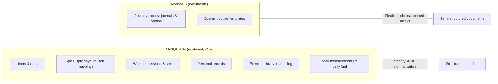

# PhysiQ: Master Project Plan & DBMS Technical Blueprint

> **Course:** DBMS Level 3 Project &bull; **Institution:** PES University &bull; **Instructor:** Dr. Nagasundari S
> **Core concept:** A database-driven personal fitness system with adaptive scheduling and progressive overload
> **Architecture:** Mobile-first PWA (Next.js 16) + polyglot persistence (MySQL 8.0+ & MongoDB)
> **Closed feedback loop:** `PLAN → TRAIN → RECORD → ANALYZE → ADAPT → TRAIN AGAIN`

> **Status (21 Oct 2026):** all 7 phases of the revised roadmap are built and tested
> on the `Gagan-iterations` branch. See [§6](#6-roadmap--status).

---

## 1. Project Overview & Problem Statement

Gym-goers track workouts, splits and body changes across fragmented apps or paper notebooks. When a scheduled workout is missed, calendar-based apps (*Monday = Push, Tuesday = Pull*) fall out of sync.

**PhysiQ** solves this with a **database-centric architecture**:
1. **Adaptive scheduling:** queries real workout history in MySQL to find the split day that is most overdue for its recovery window.
2. **Automated progressive overload:** triggers keep personal records current; a stored procedure prescribes the next weight/rep target.
3. **Daily fuel & recovery:** formula-driven protein, water and calorie targets from body weight and goal, instead of food weighing.
4. **Journey timeline (NoSQL):** post-workout journals and progress photos as flexible MongoDB documents.

---

## 2. PESU DBMS Level 3 Requirements Compliance Matrix

| Syllabus requirement | PhysiQ implementation | Artifact |
|---|---|---|
| **SQL database (mandatory)** | MySQL 8.0+, 12 tables in 3NF (`personal_records` in BCNF) | [`database/schema.sql`](database/schema.sql) |
| **NoSQL database (mandatory)** | MongoDB `custom_routines` (nested templates) + `journey_stories` (sparse journals), JSON-schema validators, indexes, cross-store id checks | [`database/mongodb/`](database/mongodb), [`src/lib/mongodb.ts`](src/lib/mongodb.ts), [`src/app/api/routines`](src/app/api/routines) |
| **Normalization** | 1NF→BCNF analysis, documented controlled denormalisation | [`docs/DATABASE_DESIGN.md`](docs/DATABASE_DESIGN.md) |
| **Role-based access (min 2 roles)** | `member` / `admin`; NextAuth + bcrypt; every query scoped by the session user; admin-only library writes. In MySQL itself the app runs as a least-privilege account (role `physiq_app`: no DDL / GRANT) and a `physiq_readonly` role exists | [`src/lib/auth.ts`](src/lib/auth.ts), [`src/lib/session.ts`](src/lib/session.ts), [`database/roles.sql`](database/roles.sql) |
| **Transactions** | Workout = session + all sets in one transaction, idempotent via `UNIQUE(user_id, client_ref)`; editing a saved workout (row lock + trigger recompute); split switching; audited admin writes | [`src/app/api/workouts/route.ts`](src/app/api/workouts/route.ts), [`src/lib/mysql.ts`](src/lib/mysql.ts) |
| **Triggers** | 11: volume, last-trained date, PR detection, `SIGNAL` validation, audit trail | [`database/triggers.sql`](database/triggers.sql) |
| **Stored procedures & functions** | `sp_get_next_body_part`, `sp_estimate_next_target`, `sp_check_and_update_pr`, `sp_rebuild_personal_records`, `sp_get_daily_fuel`, `sp_log_fuel`, `sp_rep_max_table` (recursive CTE), `sp_schema_stats` (`SQL SECURITY DEFINER`), `fn_calculate_1rm`, fuel functions… (11 + 5) | [`database/procedures.sql`](database/procedures.sql) |
| **Views** | `view_split_day_status`, `view_personal_records_detailed`, `view_weekly_summary`, `view_weekly_muscle_volume`, `view_exercise_session_best` | [`database/views.sql`](database/views.sql) |
| **Indexing & EXPLAIN** | Composite B-Tree indexes; measured 7 vs 60,019 rows examined, 0.07 ms vs 27.5 ms | [`database/indexes.sql`](database/indexes.sql), [`docs/QUERY_PERFORMANCE_EXPLAIN.md`](docs/QUERY_PERFORMANCE_EXPLAIN.md) |
| **Complex queries** | CTEs, window functions, correlated subquery, anti-join, gaps-and-islands streak, keyset pagination | [`database/queries/`](database/queries) |
| **Web interface** | Next.js 16 PWA: Today, Train/logger, Progress (incl. 1RM calculator), History (incl. edit), Profile (incl. data export), Admin | [`src/app/`](src/app) |
| **Testing** | 45 database tests (each in a rolled-back transaction) + 35 API tests + 16 browser tests (Playwright; axe-core accessibility and overflow audit of every screen at 320 / 390 / 1280 px), run on every push by GitHub Actions | [`tests/`](tests), [`.github/workflows/ci.yml`](.github/workflows/ci.yml) |

---

## 3. Polyglot Persistence Justification (SQL vs NoSQL)

* **Why MySQL for core data?** Workouts, sets, PRs and splits are relational, transactional and rule-bound. A workout saved without its sets would corrupt the history, so it must be atomic. 3NF prevents update anomalies.
* **Why MongoDB for journals and routines?** They carry sparse, evolving attributes (mood, energy, free tags, photo angle, superset groups, nested exercise lists) and are read and written as whole units. In SQL they would mean wide, mostly-NULL tables or 2–3 join tables for data never queried by its parts.

---

## 4. Feature Architecture

### Feature 1: Adaptive overdue scheduling
* `CALL sp_get_next_body_part(user_id, @day, @label, @days, @status)` reads `view_split_day_status`.
* Status per split day: *new → overdue → ready → recovering*, using each day's `min_rest_days` (overdue = rest window + 2 days).
* UI: the **Up Next** hero on Today, e.g. *"Pull, overdue. Last trained 6 days ago."*

### Feature 2: Workout logger with ACID transaction & triggers
* The device keeps the in-progress workout (refresh-safe); *Finish* sends it once.
* `BEGIN` → insert session (validated by `trg_workout_sessions_bi`, marks the split day trained) → multi-row insert of sets (`trg_sets_ai` adds volume and runs PR detection) → `COMMIT`.
* `UNIQUE(user_id, client_ref)` makes retries idempotent.

### Feature 3: Progressive overload predictor
* `sp_estimate_next_target`: if the last top set reached ≥ 10 reps, add +2.5 kg and reset to 8 reps; otherwise add +1 rep at the same load. Bodyweight lifts add a rep.
* Every set in the logger is pre-filled with this target; PRs are judged by Epley e1RM (`fn_calculate_1rm`).

### Feature 4: Daily fuel & recovery protocol
* `sp_get_daily_fuel` / `sp_log_fuel` over `user_daily_fuel`: protein 2 g/kg, water 40 ml/kg, calories ≈ 33 kcal/kg ± goal (+300 hypertrophy, +200 strength, −400 fat loss).
* Today's targets follow the latest weigh-in; past days stay frozen.
* UI: Apple-style rings with one-tap +10/+25 g and +250/+500 ml.

### Feature 5: Journey timeline (MongoDB)
* Finishing a workout stores mood, tags and journal text in `journey_stories`, linked by `session_id`, with PR highlights embedded.
* **Journey view** (Progress → Journey): chronological feed with kind and tag filters, whole-word text search (MongoDB text index), keyset paging, a mood-by-week chart and top tags from one `$facet` aggregation.
* **Progress photos:** taken or chosen on the phone, shrunk and stripped of location data in the browser, stored privately on disk and served only to their owner. Each photo records the body weight from MySQL (`fn_current_weight`). A *Then and now* slider compares the first and latest photo.
* **Milestones:** the 1st, 10th, 25th, 50th, 100th and 250th session add a story automatically.

### Feature 6: Overdue alerts
* "Overdue" is defined once, in `view_split_day_status` (recovery window + 2 days). `GET /api/alerts` only reads it.
* A banner at the top of every screen (except the live logger) names the worst overdue day with a one-tap *Train* button; dismissing it hides it until tomorrow.
* Optional **browser notification** (Profile → Reminders), shown through a service worker at most once a day when the app is opened or returns to the foreground. True background push would need a push server and stored subscriptions, which this project does not run.

---

## 5. Relational Schema & Database Artifacts

### 12 tables
1. `users` (role, goal, height, starting_weight, weekly_goal)
2. `muscle_groups` (lookup)
3. `exercises` (FK → muscle_groups)
4. `splits` (one active per user)
5. `split_days` (day_order, min_rest_days, cached last_trained_date)
6. `split_day_muscles` (M:N)
7. `workout_sessions` (split_day_id, label snapshot, times, cached total_volume, client_ref)
8. `sets`
9. `personal_records` (pointer to the best set: BCNF)
10. `body_measurements`
11. `user_daily_fuel`
12. `admin_audit_logs`

Food logging (`foods`, `nutrition_logs`) and the MySQL `progress_photos` table from
the first draft were dropped in favour of the fuel protocol and MongoDB journey
stories, as decided in the zero-bloat feature list above.

Details: [`docs/DATA_DICTIONARY.md`](docs/DATA_DICTIONARY.md) (generated from `information_schema`).

---

## 6. Roadmap & Status

The original 10 phases were regrouped into 7 (plus a final hardening phase) so that something runnable exists
after each phase, and MongoDB is used inside the main workflow rather than only
in a final feed.

| # | Phase | Covers (original phases) | Status |
|---|---|---|---|
| 1 | **Database hardening**: schema, routines, triggers, views, indexes, Mongo validators, seeds, init runner, test suite, EXPLAIN proof | 1, 2, 3, 10 (queries/EXPLAIN) | ✅ done |
| 2 | **Drivers & auth**: pool + transaction helper, Mongo singleton, NextAuth + bcrypt, RBAC guards, health check | 4, 5 | ✅ done |
| 3 | **Design system & PWA shell**: tokens, UI kit, tab bar / sidebar, manifest + icons, login, register, onboarding | 6 | ✅ done |
| 4 | **Gym-floor logger**: pre-filled plans, live logger, rest timer, PR badges, finish + journal, routines, history | 7, part of 8 | ✅ done |
| 5 | **Dashboard & insights**: activity rings + fuel, weekly stats, streak, strength and body progress, profile, admin console | 8, part of 9 | ✅ done |
| 6 | **Journey timeline & alerts**: MongoDB story feed with search, photos and milestones, overdue banner, browser notifications | 9 | ✅ done |
| 7 | **Viva prep**: ER and architecture diagrams generated from the live schema, runnable SQL and MongoDB demos, 5-minute script and 27-step walkthrough, screenshots, contribution summary, API tests and CI | 10.3 | ✅ done |
| 8 | **Hardening & quality**: 1RM calculator (`sp_rep_max_table`), edit a saved workout, least-privilege MySQL account and roles, data export, security headers + CSP, offline and error states, Next.js 16 / React 19 upgrade, Playwright + axe browser suite in CI | quality pass on 4, 5 and 10 | ✅ done |

Every phase was verified against real MySQL 8.0.46 and MongoDB 8.2:
`npm test` (45 database tests + 35 API tests + 16 browser tests, also run by GitHub Actions on every push). The browser suite walks
onboarding, a full workout, editing, the Journey, profile and admin, and audits every screen for accessibility.

---

## 7. Faculty Evaluation Script

The rehearsed 5-minute script, the 24-step walkthrough, the likely questions and answers, and the known limitations are in [docs/VIVA_DEMO.md](docs/VIVA_DEMO.md). The SQL and MongoDB parts are runnable: `database/queries/viva_demo.sql` (every write is rolled back) and `npm run viva:mongo`.

---

## 8. GitHub Collaboration

1. Work happens on personal branches (`the-DEMIGOD-iteration`, `Gagan-iterations`) and is merged into `main` after review.
2. Conventional commits (`feat(db):`, `feat(api):`, `feat(ui):`, `test(db):`, `docs(...)`).
3. Both members commit to both the database and the application, as required by the rubric.
