# PhysiQ: an adaptive, database-driven gym tracker

[](https://github.com/Gagan-1718/PhysiQ-Gym-Tracker/actions/workflows/ci.yml)

PhysiQ tells you **what to train next** and **how much to lift**. Both answers
come from your own history, computed inside the database.

There are no fixed weekdays. Miss a session and PhysiQ recommends whichever
split day is most overdue for its recovery window. Every exercise opens
pre-filled with a progressive-overload target. Logging a workout is one ACID
transaction, and triggers keep volume, personal records and recovery status
correct no matter which client writes to the database.

> DBMS Level 3 course project (PES University). **MySQL 8** holds the relational core and
> **MongoDB** holds the flexible documents and the vectors for similarity search.
> Next.js 16 serves a mobile-first PWA.

## Where the database work is

📄 **Project report** (problem statement, objectives, ER diagram, relational schema, justification,
implementation, important queries, testing results, requirement checklist):
[`docs/PROJECT_REPORT.md`](docs/PROJECT_REPORT.md)

| What | File |
|---|---|
| Tables, keys, constraints (DDL `CREATE`) | [`database/schema.sql`](database/schema.sql) |
| Schema evolution (DDL `ALTER TABLE`) | [`database/migrations/`](database/migrations) (001 nutrition tracking, 002 exercise media, 003 exercise knowledge: muscles worked, weight steps) |
| Stored procedures and functions | [`database/procedures.sql`](database/procedures.sql) |
| Triggers | [`database/triggers.sql`](database/triggers.sql) |
| Views | [`database/views.sql`](database/views.sql) |
| Indexes, and the `EXPLAIN` proof | [`database/indexes.sql`](database/indexes.sql), [`docs/QUERY_PERFORMANCE_EXPLAIN.md`](docs/QUERY_PERFORMANCE_EXPLAIN.md) |
| Roles and privileges | [`database/roles.sql`](database/roles.sql) |
| Important SQL queries (joins, `GROUP BY` / `HAVING`, subqueries, CTEs, window functions) | [`database/queries/`](database/queries) |
| MongoDB validators (data model) | [`database/mongodb/*.schema.json`](database/mongodb) |
| MongoDB queries: CRUD, indexes, text search, aggregation, **vector similarity search** | [`database/mongodb/queries.mongodb.js`](database/mongodb/queries.mongodb.js) |
| Design, normalisation, data dictionary, ER diagram | [`docs/DATABASE_DESIGN.md`](docs/DATABASE_DESIGN.md), [`docs/DATA_DICTIONARY.md`](docs/DATA_DICTIONARY.md), [`docs/diagrams/`](docs/diagrams) |

```
PLAN → TRAIN → RECORD → ANALYZE → ADAPT → TRAIN AGAIN
```

<p align="center">
  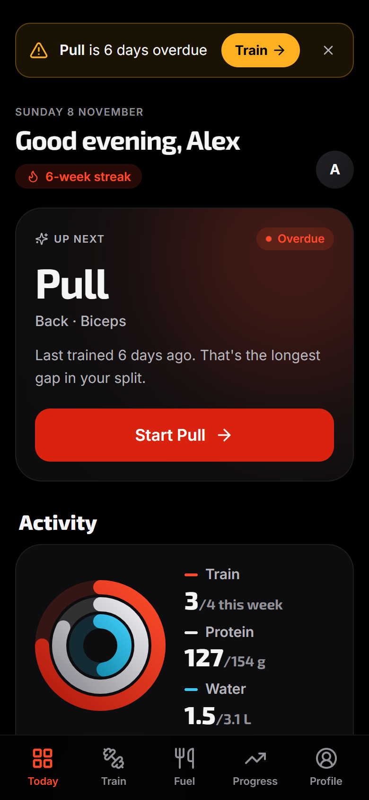
  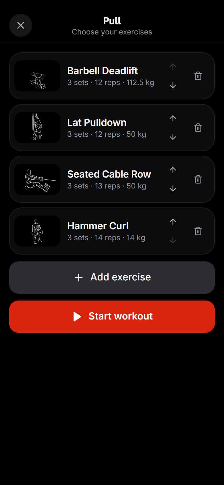
  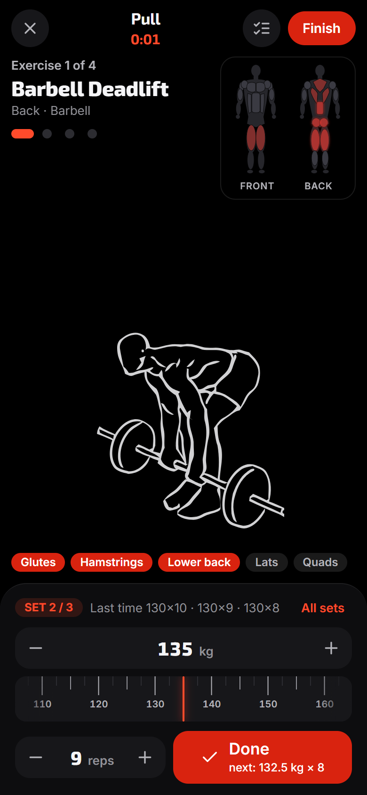
  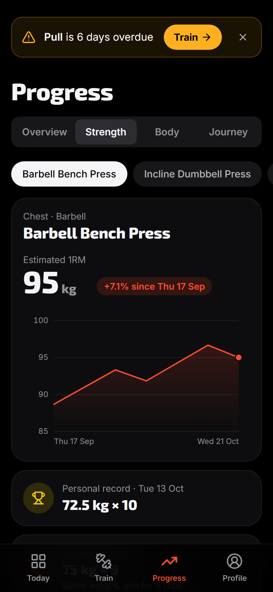
  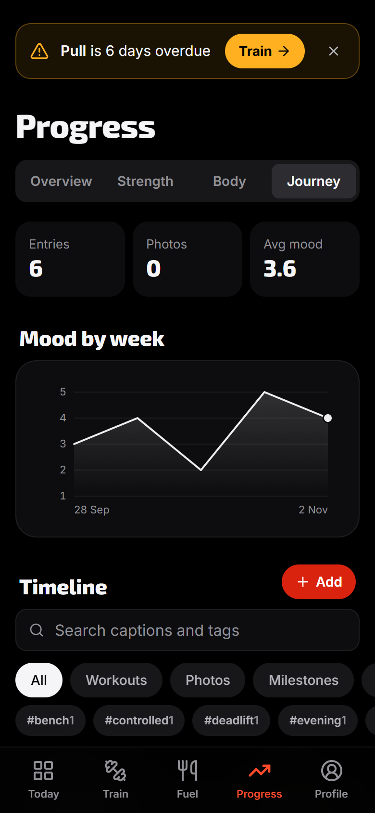
</p>
<p align="center">
  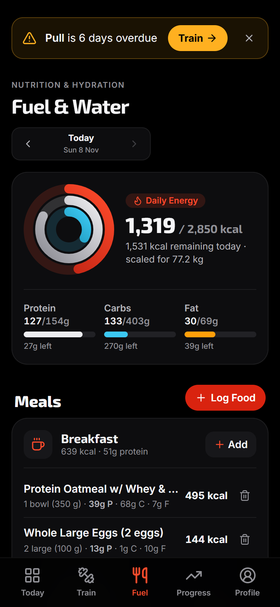
  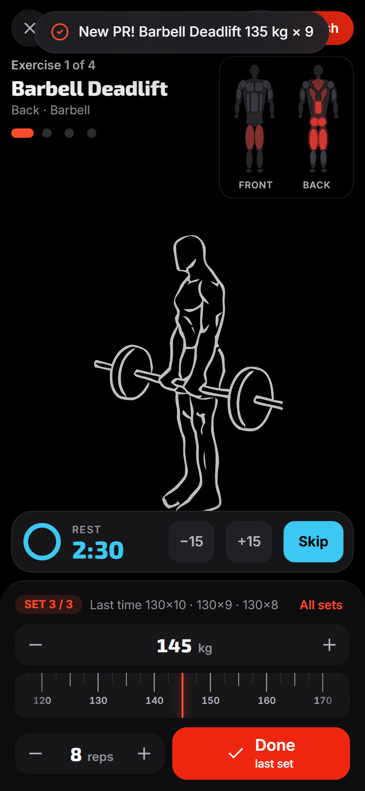
  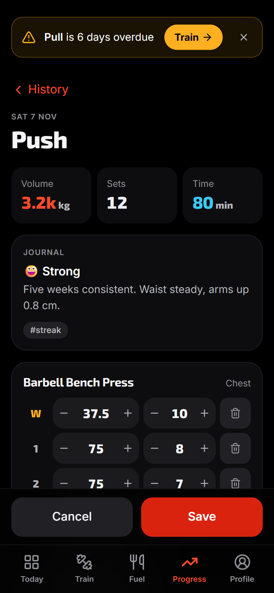
</p>
<p align="center">
  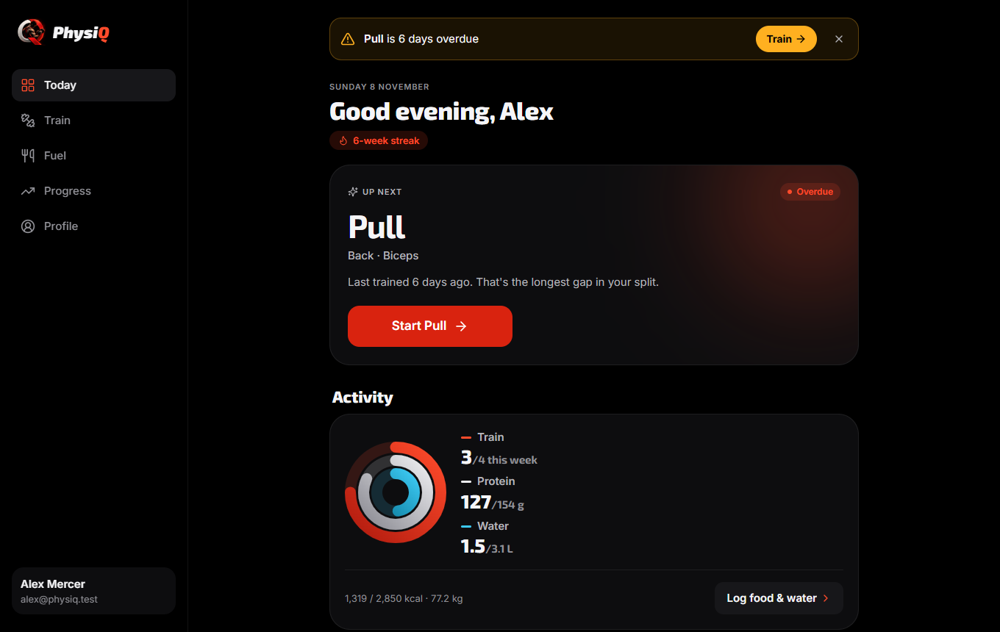
</p>

---

## Quick start

**Requirements:** Node 20.10+, MySQL 8.0+, MongoDB 6+ (local services are fine).

```bash
npm install
cp .env.example .env          # fill in MYSQL_PASSWORD, MYSQL_APP_PASSWORD and a NEXTAUTH_SECRET
npm run db:init               # builds MySQL + MongoDB, creates the app account, loads demo data
npm run dev                   # http://localhost:3000
```

**On a Mac with Homebrew MySQL and MongoDB** you can let the repo run them for you
(`npm run services:start` / `services:status` / `services:stop`). That MySQL listens on
port 3307 with no root password, so set `MYSQL_PORT=3307` and an empty `MYSQL_PASSWORD`
in `.env`. On Windows and Linux, start your own MySQL and MongoDB services instead.

**Demo accounts** (password `physiq123`):

| Email | Role | What you'll see |
|---|---|---|
| `alex@physiq.test` | member | 5 weeks of Push/Pull/Legs history. Pull is overdue, Legs ready, Push recovering. |
| `admin@physiq.test` | admin | Exercise library management and the trigger-written audit log |

The demo dates are relative to the day the database was built. Run
`npm run db:reset` for fresh dates before demonstrating.

**On your phone:** run `npm run dev -- -H 0.0.0.0`, open `http://<laptop-ip>:3000`
on the same Wi-Fi, then use *Add to Home Screen*.

| Script | Does |
|---|---|
| `npm run db:init` | First-time build. Refuses to touch an existing `physiq_db`. |
| `npm run db:reset` | **Drops** and rebuilds both databases (all data is lost) |
| `npm run test:db` | 51 database tests (constraints, exercise media and knowledge, triggers, procedures, views, nutrition, Mongo validators and indexes, least-privilege account). Each runs in a rolled-back transaction. |
| `npm run test:api` | 40 API tests against the running app (auth, roles, workouts and edits, rollback, split switching, journey, photos, export, rep-max procedure, progress, nutrition, smart search). Needs `npm run dev` or `npm start` running on a fresh `db:init`. |
| `npm run test:e2e` | 16 browser tests in a real Chromium: a whole workout, Journey photos and search, sign-up and onboarding, the guided workout (muscle map, weight ruler, +10 kg next set, PR), admin, and an **accessibility + overflow audit of every screen at 320, 390 and 1280 px**. Needs the app running on a fresh `db:reset`; set `PW_EXECUTABLE` to use an installed Chrome or Edge, otherwise run `npx playwright-core install chromium` once. |
| `npm test` | All three suites |
| `npm run viva:mongo` | MongoDB half of the viva demo (validator, indexes, plans, text search, aggregation) |
| `npm run docs:dictionary` / `docs:er` / `docs:contributions` | Regenerate the data dictionary, ER diagram source and contribution summary from the live database / git |
| `npm run typecheck` / `build` | TypeScript check / production build |
| `npm run brand:assets` | Re-cuts the app icons, favicon and in-app logo from `design/physiq-logo.png` |
| `npm run docs:screenshots` | Re-takes every screenshot in `docs/screenshots` from the running app (needs a fresh `db:reset`) |
| `npm run media:exercises` | Downloads the exercise demonstration drawings (everkinetic, CC BY-SA 4.0) into `public/exercises` |

GitHub Actions audits the runtime dependencies, type-checks, builds both databases
from the repo files, runs `npm run test:db`, builds the app, then runs
`npm run test:api` and `npm run test:e2e` against the production build on every push.

---

## What's inside

### The app
- **Today:** the adaptive *Up Next* recommendation, an **overdue banner** and activity rings (sessions this week, protein, water). Also the recovery status of every split day, an 8-week volume chart, recent PRs and an activity streak.
- **Train:** start the recommended day, already filled with last session's exercises and today's targets. You can also start a saved routine or a freestyle workout, change your split, and find exercises or alternatives with **smart search** (MongoDB vectors).
- **Guided workout:** first choose, remove or reorder the exercises, then *Start*. Then **one set at a time**, on a full-screen stage: the **animated demonstration** (an illustrated figure moving between the start and end position) and a **body map with the worked muscles in red** (main muscles glow, helpers are lighter). The weight is already set: last session's target, or on the first time a **starting weight from your body weight**. Change it on a **swipe ruler** (or the ± buttons), tap **Done**, and the rest timer starts while the **next set goes up by itself** (+10 kg on squats and deadlifts, +5 kg on most barbell and machine lifts, +2.5 kg on dumbbells; bodyweight moves stay at 0). Live PR badges; after the last set, *Next exercise*. The clock stops 30 minutes after the last set, so a forgotten workout never runs for hours. The workout lives on the device until *Finish*, so a refresh or bad gym signal never loses sets.
- **Fuel:** calories, protein, carbs and fat against targets computed in MySQL from your weight and goal. Log meals from the food library (28 staples plus your own foods); the search also finds foods by meaning ("high protein snack") through **smart search**. Water is two taps (+250 / +500 ml). Triggers keep the daily totals in sync.
- **Progress:** weekly volume, sets per muscle against the 10–20 set range, e1RM trend per exercise with the next target, body weight, and the **Journey**.
- **Journey (MongoDB):** a timeline of workout journals, notes, **progress photos** and automatic milestones, with filters, whole-word search, a mood-by-week chart, and a *Then and now* photo slider. Photos are private, resized on the phone, and stripped of location data.
- **History:** every session with sets, PR flags and the journal. **Edit** a saved workout (weights, reps, warm-up flags, removed sets) and the UPDATE / DELETE triggers recompute volume and PRs. Deleting a session rolls back PRs and recovery automatically.
- **Profile:** goal, weekly session goal, height (cm or ft/in), split switching (recovery carries over to the new split), **download all your data as JSON**, account deletion (both databases).
- **Sign-up:** pick a goal, enter height and weight in metric or imperial, and choose a split.
- **Admin:** manage the exercise library and read the audit log.
- **Built for the gym floor:** an offline badge (anything you were logging stays on the device), friendly error and 404 pages, and a layout that holds from 320 px phones to a laptop (set rows stack weight and reps on the narrowest screens).

### The database (the point of the project)

<p align="center">
  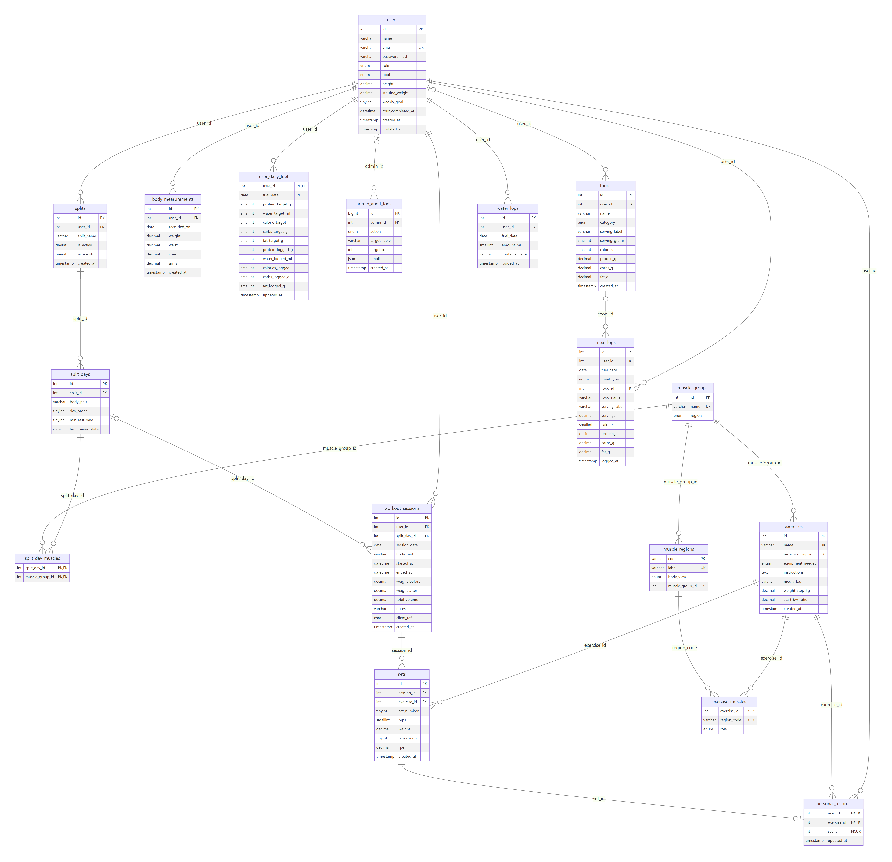
</p>

| Concept | Where |
|---|---|
| 17-table schema in 3NF (`personal_records`, `muscle_regions`, `exercise_muscles` in BCNF): a 12-table base design plus four migrations that use `ALTER TABLE` (calorie and macro columns; exercise demonstration media; weight step and starting-weight ratio) and add 5 tables, including the M:N `exercise_muscles` behind the red body map | `database/schema.sql`, `database/migrations/` |
| 35 CHECK constraints, 22 foreign keys, a one-active-split rule via generated column + unique index, an idempotency key | `schema.sql` |
| 15 triggers: volume, last-trained date, PR detection, `SIGNAL` validation, daily fuel totals, audit trail | `database/triggers.sql` |
| 15 procedures and 8 functions: adaptive scheduler, overload estimator, a first-timer's starting weight from body weight, fuel and macro targets, meal and water logging, PR rebuild (window function), rep-max table (recursive CTE), schema stats (`SQL SECURITY DEFINER`) | `database/procedures.sql` |
| 7 views: recovery status with priority rank, PRs, weekly volume, sets per muscle, per-session bests, daily nutrition, hydration | `database/views.sql` |
| Composite indexes with **real** EXPLAIN / EXPLAIN ANALYZE proof (7 rows vs 60,019; 0.07 ms vs 27.5 ms) | `database/indexes.sql`, `docs/QUERY_PERFORMANCE_EXPLAIN.md` |
| ACID workout logging, split switching (recovery carries over through one correlated `UPDATE`), audited admin writes | `src/app/api/workouts`, `src/app/api/splits`, `src/lib/mysql.ts` |
| Analytical suite: CTEs, window functions (`ROW_NUMBER`, `LAG`, running `MAX`), correlated subquery, anti-join, gaps-and-islands | `database/queries/` |
| MongoDB: `custom_routines`, `journey_stories` and `vector_embeddings` with JSON-schema validators, compound / multikey / **text** indexes, keyset paging, a `$facet` aggregation and **cosine-similarity search** over 32-d vectors in an aggregation pipeline | `database/mongodb/`, `src/app/api/journey`, `src/app/api/routines`, `src/lib/vector.ts` |
| RBAC: `member` / `admin`, bcrypt, every query scoped by the session user | `src/lib/auth.ts`, `src/lib/session.ts` |
| **Least privilege in MySQL:** the web app connects as its own account (`MYSQL_APP_USER`) holding the `physiq_app` role: row access + `EXECUTE`, no DDL, no `GRANT`; a `physiq_readonly` role exists for reporting. Privileges are tested. | `database/roles.sql`, `scripts/init-db.js`, `tests/db/privileges.test.js` |
| Security headers and a production Content-Security-Policy (same-origin only, no framing); API responses are never cached | `next.config.mjs` |

<p align="center">
  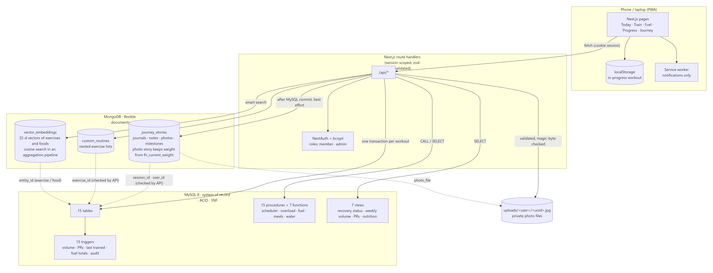
</p>

Full write-up: [`docs/PROJECT_REPORT.md`](docs/PROJECT_REPORT.md) · [`docs/DATABASE_DESIGN.md`](docs/DATABASE_DESIGN.md) ·
[`docs/DATA_DICTIONARY.md`](docs/DATA_DICTIONARY.md) ·
[`docs/QUERY_PERFORMANCE_EXPLAIN.md`](docs/QUERY_PERFORMANCE_EXPLAIN.md) ·
[`docs/VIVA_DEMO.md`](docs/VIVA_DEMO.md) (5-minute script, 29-step walkthrough, likely questions) ·
[`docs/CONTRIBUTIONS.md`](docs/CONTRIBUTIONS.md) ·
[`PLAN.md`](PLAN.md)

---

## Project structure

```text
database/
  schema.sql  procedures.sql  triggers.sql  views.sql  indexes.sql  roles.sql
  migrations/  001_nutrition_tracking.sql, 002_exercise_media.sql, 003_exercise_knowledge.sql (ALTER TABLE)
  seeds/       exercises.sql (44 movements, 28 foods), demo_data.sql (generated)
  mongodb/     validators, queries.mongodb.js (all MongoDB queries), viva_demo.js
  queries/     analytical suite, EXPLAIN benchmark, viva_demo.sql
docs/          project report, design, data dictionary (generated), EXPLAIN proof, viva guide,
               diagrams/, screenshots/, CONTRIBUTIONS.md (generated)
scripts/       init-db.js (DELIMITER-aware runner), test runner, generators
tests/db/      node:test suite against MySQL + MongoDB
tests/api/     node:test suite against the running app
tests/e2e/     Playwright + axe-core browser suite (flows, accessibility, overflow)
.github/       CI workflow
src/
  app/(auth)   login, register
  app/(app)    today, train, train/session, fuel, history, progress, profile, admin
  app/api/     route handlers (zod-validated, session-scoped)
  components/  ui kit, charts, logger, today, train, fuel, progress, journey, alerts, shell
  lib/         mysql.ts, mongodb.ts, auth.ts, vector.ts, goals.ts, photos.ts, journey.ts, …
public/        icons, exercise demonstration drawings (everkinetic, CC BY-SA 4.0, see public/exercises/CREDITS.txt)
```

## Tech stack
Next.js 16 (App Router) · React 19 · TypeScript · Tailwind CSS · Framer Motion · SWR ·
NextAuth (credentials + bcrypt) · mysql2 · MongoDB Node driver · zod.
Tested with node:test, Playwright and axe-core (WCAG 2.2 AA).
Inter + Exo 2 type on a true-black canvas, in the logo's red and silver.
