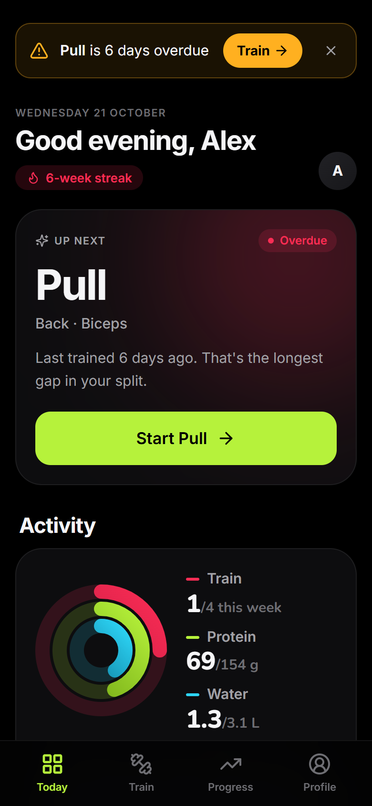
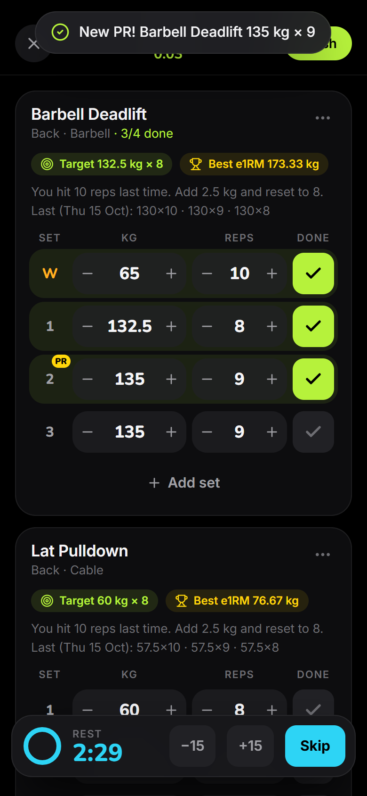
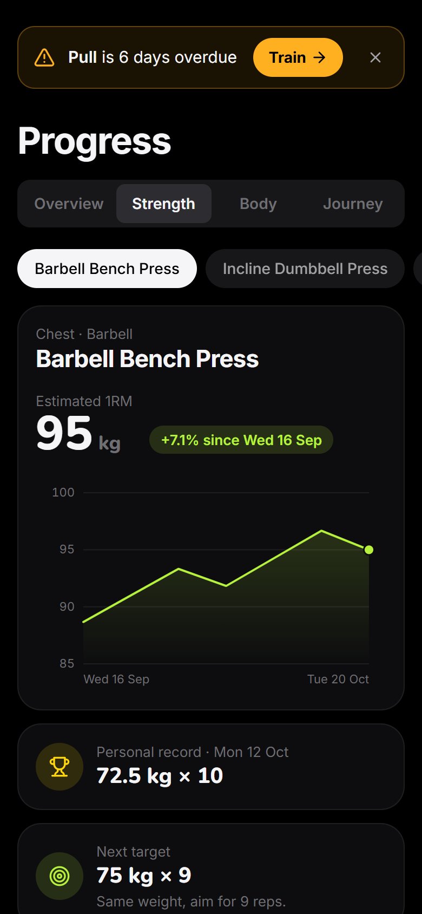
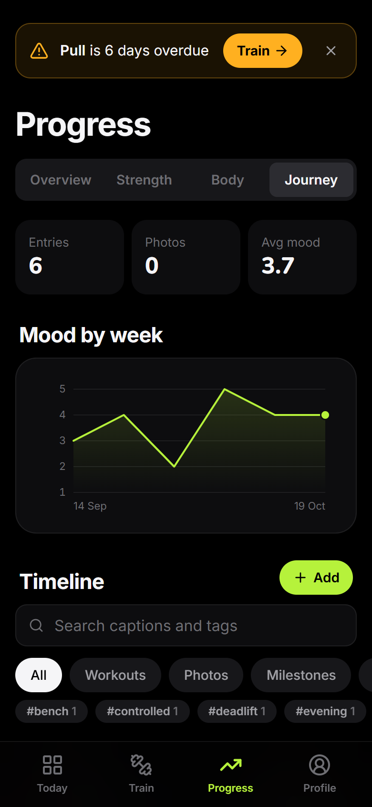
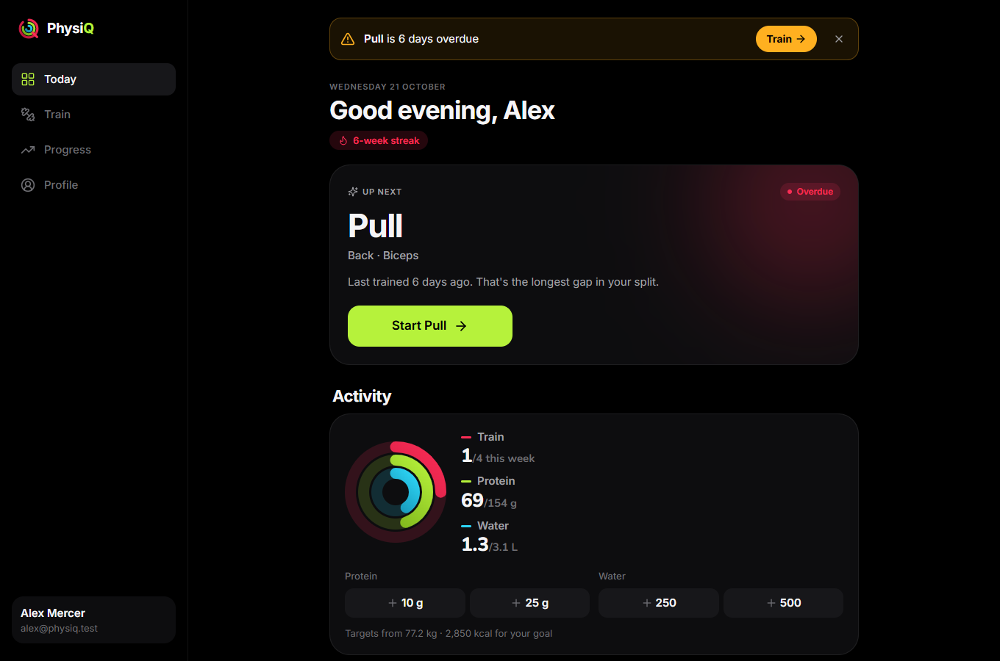
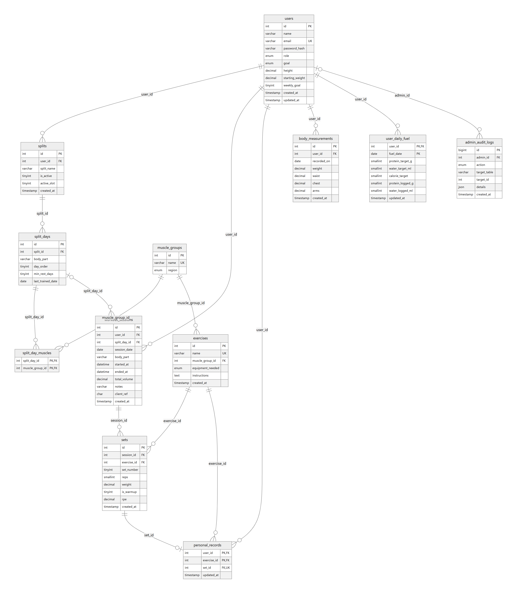
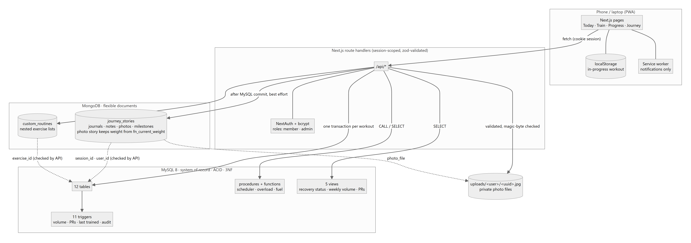

# PhysiQ: an adaptive, database-driven gym tracker

[](https://github.com/Gagan-1718/PhysiQ-Gym-Tracker/actions/workflows/ci.yml)

PhysiQ tells you **what to train next** and **how much to lift**. Both answers
come from your own history, computed inside the database.

There are no fixed weekdays. Miss a session and PhysiQ recommends whichever
split day is most overdue for its recovery window. Every exercise opens
pre-filled with a progressive-overload target. Logging a workout is one ACID
transaction, and triggers keep volume, personal records and recovery status
correct no matter which client writes to the database.

> DBMS course project (PES University). **MySQL 8** holds the relational core and
> **MongoDB** holds the flexible documents. Next.js 16 serves a mobile-first PWA.

```
PLAN → TRAIN → RECORD → ANALYZE → ADAPT → TRAIN AGAIN
```

<p align="center">
  
  
  
  
</p>
<p align="center">
  
</p>

---

## Quick start

**Requirements:** Node 20.10+, MySQL 8.0+, MongoDB 6+ (local services are fine).

```bash
npm install
cp .env.example .env          # fill in MYSQL_PASSWORD, MYSQL_APP_PASSWORD and a NEXTAUTH_SECRET
npm run db:init               # builds MySQL + MongoDB, creates the app account, loads demo data
npm run dev                   # http://localhost:3000
```

**Demo accounts** (password `physiq123`):

| Email | Role | What you'll see |
|---|---|---|
| `alex@physiq.test` | member | 5 weeks of Push/Pull/Legs history. Pull is overdue, Legs ready, Push recovering. |
| `admin@physiq.test` | admin | Exercise library management and the trigger-written audit log |

The demo dates are relative to the day the database was built. Run
`npm run db:reset` for fresh dates before demonstrating.

**On your phone:** run `npm run dev -- -H 0.0.0.0`, open `http://<laptop-ip>:3000`
on the same Wi-Fi, then use *Add to Home Screen*.

| Script | Does |
|---|---|
| `npm run db:init` | First-time build. Refuses to touch an existing `physiq_db`. |
| `npm run db:reset` | **Drops** and rebuilds both databases (all data is lost) |
| `npm run test:db` | 45 database tests (constraints, triggers, procedures, views, Mongo validators and indexes, least-privilege account). Each runs in a rolled-back transaction. |
| `npm run test:api` | 35 API tests against the running app (auth, roles, workouts and edits, rollback, journey, photos, export, 1RM calculator, progress). Needs `npm run dev` or `npm start` running on a fresh `db:init`. |
| `npm run test:e2e` | 16 browser tests in a real Chromium: a whole workout, Journey photos and search, sign-up and onboarding, admin, and an **accessibility + overflow audit of every screen at 320, 390 and 1280 px**. Needs the app running on a fresh `db:reset`; set `PW_EXECUTABLE` to use an installed Chrome or Edge, otherwise run `npx playwright-core install chromium` once. |
| `npm test` | All three suites |
| `npm run viva:mongo` | MongoDB half of the viva demo (validator, indexes, plans, text search, aggregation) |
| `npm run docs:dictionary` / `docs:er` / `docs:contributions` | Regenerate the data dictionary, ER diagram source and contribution summary from the live database / git |
| `npm run typecheck` / `build` | TypeScript check / production build |

GitHub Actions audits the runtime dependencies, type-checks, builds both databases
from the repo files, runs `npm run test:db`, builds the app, then runs
`npm run test:api` and `npm run test:e2e` against the production build on every push.

---

## What's inside

### The app
- **Today:** the adaptive *Up Next* recommendation, an **overdue banner** and activity rings (sessions this week, protein, water) with one-tap fuel logging. Also the recovery status of every split day, an 8-week volume chart, recent PRs and an activity streak.
- **Train:** start the recommended day, already filled with last session's exercises and today's targets. You can also start a saved routine or an empty workout.
- **Live logger:** big one-thumb steppers, tap ✓ per set, an automatic rest timer (vibration and chime), live PR badges, and the screen stays awake. The workout lives on the device until *Finish*, so a refresh or bad gym signal never loses sets.
- **Progress:** weekly volume, sets per muscle against the 10–20 set range, e1RM trend per exercise with the next target, body weight, and the **Journey**.
- **Journey (MongoDB):** a timeline of workout journals, notes, **progress photos** and automatic milestones, with filters, whole-word search, a mood-by-week chart, and a *Then and now* photo slider. Photos are private, resized on the phone, and stripped of location data.
- **History:** every session with sets, PR flags and the journal. Deleting a session rolls back PRs and recovery automatically.
- **Profile:** goal, weekly session goal, height, split switching, reminders, account deletion (both databases).
- **Admin:** manage the exercise library and read the audit log.
- **Reminders:** an optional once-a-day browser notification when a split day is overdue.

### The database (the point of the project)

<p align="center">
  
</p>

| Concept | Where |
|---|---|
| 12-table schema in 3NF (`personal_records` in BCNF) | `database/schema.sql` |
| CHECK constraints, a one-active-split rule via generated column + unique index, an idempotency key | `schema.sql` |
| 11 triggers: volume, last-trained date, PR detection, `SIGNAL` validation, audit trail | `database/triggers.sql` |
| 9 procedures and 5 functions: adaptive scheduler, overload estimator, fuel targets, PR rebuild (window function) | `database/procedures.sql` |
| 5 views: recovery status with priority rank, PRs, weekly volume, sets per muscle, per-session bests | `database/views.sql` |
| Composite indexes with **real** EXPLAIN / EXPLAIN ANALYZE proof (7 rows vs 60,019; 0.07 ms vs 27.5 ms) | `database/indexes.sql`, `docs/QUERY_PERFORMANCE_EXPLAIN.md` |
| ACID workout logging, split switching, audited admin writes | `src/app/api/workouts`, `src/app/api/splits`, `src/lib/mysql.ts` |
| Analytical suite: CTEs, window functions (`ROW_NUMBER`, `LAG`, running `MAX`), correlated subquery, anti-join, gaps-and-islands | `database/queries/` |
| MongoDB: `custom_routines` and `journey_stories` with JSON-schema validators, compound / multikey / **text** indexes, keyset paging and a `$facet` aggregation | `database/mongodb/`, `src/app/api/journey`, `src/app/api/routines` |
| RBAC: `member` / `admin`, bcrypt, every query scoped by the session user | `src/lib/auth.ts`, `src/lib/session.ts` |

<p align="center">
  
</p>

Full write-up: [`docs/DATABASE_DESIGN.md`](docs/DATABASE_DESIGN.md) ·
[`docs/DATA_DICTIONARY.md`](docs/DATA_DICTIONARY.md) ·
[`docs/QUERY_PERFORMANCE_EXPLAIN.md`](docs/QUERY_PERFORMANCE_EXPLAIN.md) ·
[`docs/VIVA_DEMO.md`](docs/VIVA_DEMO.md) (5-minute script, 24-step walkthrough, likely questions) ·
[`docs/CONTRIBUTIONS.md`](docs/CONTRIBUTIONS.md) ·
[`PLAN.md`](PLAN.md)

---

## Project structure

```text
database/
  schema.sql  procedures.sql  triggers.sql  views.sql  indexes.sql
  seeds/       exercises.sql (44 movements), demo_data.sql (generated)
  mongodb/     validators, viva_demo.js
  queries/     analytical suite, EXPLAIN benchmark, viva_demo.sql
docs/          design, data dictionary (generated), EXPLAIN proof, viva guide,
               diagrams/, screenshots/, CONTRIBUTIONS.md (generated)
scripts/       init-db.js (DELIMITER-aware runner), test runner, generators
tests/db/      node:test suite against MySQL + MongoDB
tests/api/     node:test suite against the running app
.github/       CI workflow
src/
  app/(auth)   login, register
  app/(app)    today, train, train/session, history, progress, profile, admin
  app/api/     route handlers (zod-validated, session-scoped)
  components/  ui kit, charts, logger, today, progress, journey, alerts, shell
  lib/         mysql.ts, mongodb.ts, auth.ts, photos.ts, journey.ts, notifications.ts, …
public/        icons, service worker (notifications only)
```

## Tech stack
Next.js 14 (App Router) · TypeScript · Tailwind CSS · Framer Motion · SWR ·
NextAuth (credentials + bcrypt) · mysql2 · MongoDB Node driver · zod.
Inter + Nunito type, with a dark design in the style of Apple Fitness.
