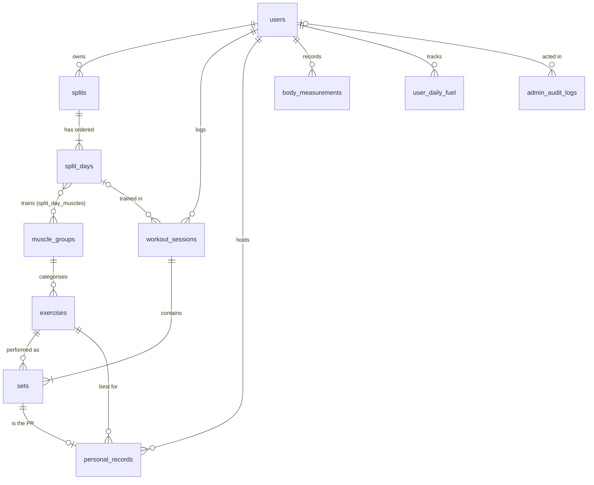

# PhysiQ Database Design

PhysiQ uses **polyglot persistence**:

- **MySQL 8.0** holds everything relational, transactional and rule-bound: users,
  splits, workouts, sets, PRs, measurements, fuel and the audit trail.
- **MongoDB** holds nested, sparse, evolving documents: routine templates and the
  journey timeline.

The core rule of the project is **the database decides**. Recommendations,
overload targets, PR detection, volume and recovery status are computed by
triggers, procedures and views inside MySQL, not in application code.

```
PLAN → TRAIN → RECORD → ANALYZE → ADAPT → TRAIN AGAIN
        │        │         │          │
     logger   ACID txn   views    sp_get_next_body_part
              triggers            sp_estimate_next_target
```

---

## 1. Why two databases?

| Data | Store | Why |
|---|---|---|
| Users, splits, sessions, sets, PRs, measurements, fuel, audit | **MySQL** | Strict structure, relationships everywhere, multi-row writes that must be atomic (a session and its sets), and integrity rules (FKs, CHECKs, triggers). 3NF prevents update anomalies in the training history. |
| `custom_routines` | **MongoDB** | A routine is an ordered list of exercises with per-exercise targets and optional superset groups. It is read and written as one unit. In SQL this needs 2–3 extra tables and joins for something that is never queried by its parts. |
| `journey_stories` | **MongoDB** | Journals and progress photos carry sparse, changing attributes: mood, energy, tags, photo angle, free-form highlights. A table would be wide and mostly NULL, and every new attribute would need a migration. The validator still enforces the fields that matter. |

**Cross-store references.** Mongo documents store MySQL ids (`user_id`,
`exercise_id`, `session_id`). No database can enforce an FK across stores, so
the API checks that every referenced id exists in MySQL before writing to
Mongo. Deleting a user also deletes their Mongo documents.

---

## 2. Entity-relationship model (MySQL)



| Relationship | Cardinality | Delete rule |
|---|---|---|
| users → splits → split_days | 1:N:N | CASCADE |
| split_days ↔ muscle_groups | M:N via `split_day_muscles` | CASCADE / RESTRICT |
| users → workout_sessions → sets | 1:N:N | CASCADE |
| split_days → workout_sessions | 1:N (optional) | SET NULL (history survives a split change) |
| exercises → sets | 1:N | RESTRICT (a trained exercise cannot vanish) |
| sets → personal_records | 1:0..1 | CASCADE (then triggers promote the next best) |

---

## 3. Normalisation

### 1NF
Every column is atomic and there are no repeating groups. Sets, split days and
muscle mappings are rows in their own tables rather than lists in a column.

### 2NF
Every table with a composite key has only full-key dependencies:

- `split_day_muscles (split_day_id, muscle_group_id)`: no non-key columns.
- `personal_records (user_id, exercise_id)`: `set_id` depends on the whole key
  (the best set *for this user and this exercise*).
- `user_daily_fuel (user_id, fuel_date)`: targets and progress are facts about
  *that user on that day*, not about the user alone or the date alone.

### 3NF
There are no transitive dependencies. Examples of what we deliberately did not store:

| Not stored | Why | Where it comes from |
|---|---|---|
| `exercises.muscle_group` text | `exercise → muscle_group_id → name` would be transitive | `muscle_groups` lookup |
| PR weight / reps / date | `set_id → weight, reps` would be transitive | join through `set_id` (`view_personal_records_detailed`) |
| Estimated 1RM | function of `(weight, reps)` | `fn_calculate_1rm` |
| Weekly totals | aggregates | `view_weekly_summary`, `view_weekly_muscle_volume` |
| Recovery status | function of date and rest window | `view_split_day_status` |

### BCNF: `personal_records`
The table has two candidate keys, `(user_id, exercise_id)` and `set_id`. Every
functional dependency has a superkey on its left-hand side:
`(user_id, exercise_id) → set_id` and `set_id → (user_id, exercise_id)`.
So the table is in BCNF.

### Controlled denormalisation (documented exceptions)

| Column | Derivable from | Why we cache it | How it stays correct |
|---|---|---|---|
| `split_days.last_trained_date` | `MAX(workout_sessions.session_date)` | read on every dashboard load by the scheduler | triggers on session insert, update and delete |
| `workout_sessions.total_volume` | `SUM(weight × reps)` of working sets | history lists show volume per session | triggers on set insert, update and delete |

`npm run test:db` proves both caches stay in sync through inserts, edits,
deletes, backdated logs and cascades.

**Snapshot attributes (not redundancy).** `workout_sessions.body_part` stores
the label at training time, so renaming or deleting a split never rewrites
history. `user_daily_fuel` targets are frozen once a day is over, so a later
weigh-in does not change past days.

---

## 4. Integrity: declarative first, triggers for the rest

| Rule | Mechanism |
|---|---|
| Valid ranges (reps 1–100, RPE 1–10, weight ≥ 0, body metrics) | `CHECK` constraints |
| One active split per user | generated column `active_slot = IF(is_active,1,NULL)` + `UNIQUE(user_id, active_slot)` |
| No duplicate set numbers per exercise in a session | `UNIQUE(session_id, exercise_id, set_number)` |
| One measurement per user per day (a second log updates it via `ON DUPLICATE KEY UPDATE`) | `UNIQUE(user_id, recorded_on)` |
| A retried workout submit cannot create a duplicate | `UNIQUE(user_id, client_ref)` |
| Weekly session goal between 1 and 7 | `CHECK (weekly_goal BETWEEN 1 AND 7)` |
| No future workouts (CHECK cannot use `CURRENT_DATE`) | `BEFORE INSERT/UPDATE` trigger → `SIGNAL SQLSTATE '45000'` |
| A session's split day must belong to the same user (cross-table) | same trigger |
| A session can never change owner | `BEFORE UPDATE` trigger |

---

## 5. Server-side logic

### Triggers (11)
| Trigger | Fires | Does |
|---|---|---|
| `trg_workout_sessions_bi` / `_bu` | before insert/update | validation (future date, split-day ownership, owner change) |
| `trg_workout_sessions_ai` | after insert | `last_trained_date = GREATEST(old, new)` (never regresses) |
| `trg_workout_sessions_au` | after update | recompute affected days when the date or day changes |
| `trg_workout_sessions_ad` | after delete | recompute the day and rebuild the user's PRs (cascaded sets fire no triggers) |
| `trg_sets_ai` / `_au` / `_ad` | after set change | maintain `total_volume` and re-check the PR |
| `trg_exercises_ai` / `_au` / `_ad` | after library change | write `admin_audit_logs` with before/after JSON and the acting admin (`@app_user_id`) |

### Procedures and functions
| Routine | Purpose |
|---|---|
| `sp_get_next_body_part` | adaptive scheduling: highest-priority day of the active split (OUT params) |
| `sp_estimate_next_target` | double progression: 10+ reps → +2.5 kg at 8; otherwise +1 rep |
| `sp_check_and_update_pr` / `sp_rebuild_personal_records` | PR maintenance (the rebuild uses `ROW_NUMBER()`) |
| `sp_get_daily_fuel` / `sp_log_fuel` / `sp_ensure_daily_fuel` | daily protein, water and calorie targets and progress |
| `sp_assert_valid_session`, `sp_refresh_last_trained` | helpers used by the triggers |
| `fn_calculate_1rm` | Epley: `w × (1 + reps/30)` |
| `fn_current_weight` | latest weigh-in on or before a date, else starting weight |
| `fn_protein_target_g`, `fn_water_target_ml`, `fn_calorie_target` | 2 g/kg, 40 ml/kg, ~33 kcal/kg ± goal |

### Views
`view_split_day_status` (recovery status and priority rank),
`view_personal_records_detailed`, `view_weekly_summary`,
`view_weekly_muscle_volume`, `view_exercise_session_best`.

### Notable queries in the API
- **Last session per exercise** (`/api/train/context`): `ROW_NUMBER() OVER (PARTITION BY exercise_id ORDER BY session_date DESC)` in a CTE.
- **Activity streak** (`/api/progress`): a *gaps-and-islands* query. `week_index − ROW_NUMBER()` is constant inside an unbroken run of training weeks, so `GROUP BY` that value gives each streak's length.
- **History paging** (`/api/workouts`): keyset pagination on `(session_date, id) < (?, ?)` served by `idx_workout_sessions_user_date`. It avoids `OFFSET`, which gets slower the deeper you page.

---

## 6. Transactions

**Logging a workout** (`POST /api/workouts`) is one ACID transaction:

```
BEGIN
  INSERT workout_sessions (… client_ref)  -- trigger: validate, mark split day trained
  INSERT sets × n  (one multi-row INSERT) -- triggers: add volume, detect PRs
COMMIT                                    -- or ROLLBACK on any error: nothing is half-saved
SELECT total_volume, new PRs              -- read back what the triggers computed
```

**Idempotency.** Each workout carries a `client_ref` UUID generated on the phone.
`UNIQUE (user_id, client_ref)` means a double tap on *Finish* or a network retry
fails with a duplicate-key error. The API catches that and returns the session
that was already saved, so a duplicate workout can never be created.

**Cross-store write order.** The journal (mood, tags, text) is written to MongoDB
only after the MySQL transaction commits. If MongoDB is unavailable, the workout
is still saved and the API returns a warning. The relational record is never
held hostage by the document store.

**Switching splits** is also one transaction: deactivate the old split, insert
the new split, its days and their muscle mappings. The one-active-split unique
index makes it impossible to end up with two active splits even if two
requests race.

---

## 7. Roles (RBAC)

| Role | Can |
|---|---|
| `member` | read and write only their own data (every query is scoped by the session user id, never by a client-supplied id) |
| `admin` | everything a member can, plus manage the exercise library and read the audit log |

Passwords are bcrypt-hashed (10 rounds). All SQL uses parameterised queries.

---

## 8. MongoDB collections

| Collection | Validator highlights | Indexes |
|---|---|---|
| `custom_routines` | `user_id` int, 1–20 exercises, each with `exercise_id`, `target_sets` 1–10, optional rep range, rest and superset letter | unique `(user_id, name)`, `(user_id, last_used_at)` |
| `journey_stories` | `kind` enum, `date` `YYYY-MM-DD`, mood/energy 1–5, ≤ 12 tags, optional `photo_file` (UUID + extension) and `milestone`; **extra fields allowed** | `(user_id, date, created_at)` timeline, `(user_id, kind, date)` filtered feed, `(user_id, tags)` multikey, sparse `session_id`, **text index** on `caption` + `tags` |

Validators are applied with `validationLevel: strict` and
`validationAction: error`, and `npm run test:db` checks them.

### What the journey uses MongoDB for

| Feature | MongoDB capability | Where |
|---|---|---|
| Chronological feed, newest first, no `OFFSET` | compound index + **keyset paging** on `(date, _id)` | `GET /api/journey` |
| Filter by kind or tag | `(user_id, kind, date)` index and the **multikey** tags index | same |
| Search captions and tags | **`$text` search** with weights (caption 2, tags 1). Every query also filters by `user_id`, so members only search their own stories | same |
| Mood by week, top tags, counts per kind | one **aggregation** using `$facet`: `$group`, `$dateTrunc` (Monday weeks), `$unwind`, `$sort`, `$limit` | `GET /api/journey/insights` |
| Workout journals with embedded PR highlights | **nested arrays** of free-form objects, written after the MySQL commit | `POST /api/workouts` |
| Milestone stories (1st, 10th, 25th, 50th, 100th, 250th session) | counts sessions in MySQL, inserts once (idempotent check) | `src/lib/milestones.ts` |

### Progress photos: where the bytes live

Image files are **not** stored in either database. The story document keeps the file name,
the angle, and the **body weight in force on that date, read from MySQL with
`fn_current_weight`** (a small example of the two stores cooperating).

- Files go to `uploads/<user_id>/<uuid>.<ext>`, outside `public/`, and are served only by `/api/photos/<file>`. That route builds the folder from the **session** user id, so another member's file name returns 404.
- The type is decided from the file's **magic bytes** (JPEG, PNG and WebP only; SVG and HTML are rejected even when named `.png`). Max 6 MB, server-generated names, no path traversal.
- The browser shrinks photos to 1600 px and re-encodes them as JPEG before upload, which also **removes EXIF and GPS data**.
- Deleting a story deletes its file. If the document insert fails, the just-saved file is removed.

### Cross-store consistency rules
1. MySQL is the system of record. MongoDB writes happen **after** the MySQL commit and are best-effort: a failure returns a warning and never loses the workout.
2. Ids that point at MySQL (`user_id`, `exercise_id`, `session_id`) are checked by the API before a Mongo write.
3. Deleting an account removes the MySQL rows (FK cascades) and then the member's Mongo documents.

---

## 9. Files and commands

| File | Contents |
|---|---|
| `database/schema.sql` | 12 tables |
| `database/procedures.sql` | functions and procedures (loaded before triggers) |
| `database/triggers.sql` | 11 triggers |
| `database/views.sql` | 5 views |
| `database/indexes.sql` | composite indexes |
| `database/seeds/` | exercise library, demo data (generated by `scripts/generate-demo-data.js`) |
| `database/mongodb/` | JSON-schema validators |
| `database/queries/` | analytical suite, EXPLAIN benchmark |

```bash
npm run db:init     # first-time build of MySQL + MongoDB (refuses if physiq_db exists)
npm run db:reset    # DROP and rebuild (destroys data)
npm run test:db     # 36 tests, each inside a rolled-back transaction
```
