# PhysiQ: an adaptive, database-driven gym tracker

**DBMS Experiential Learning, Level 3 project report** · PES University · Instructor: Dr. Nagasundari S

| | |
|---|---|
| Team | Gagandeep N ([Gagan-1718](https://github.com/Gagan-1718)) · Dhruvanth ([theDEMIGOD600](https://github.com/theDEMIGOD600)) |
| Database option | **Option 1: SQL + NoSQL**: MySQL 8 (mandatory SQL) and MongoDB, with vector similarity search inside MongoDB |
| Stack | Next.js 16 (App Router, route handlers), React 19, TypeScript, mysql2, MongoDB Node driver, NextAuth |
| Repository | https://github.com/Gagan-1718/PhysiQ-Gym-Tracker (branch `Gagan-iterations`) |

The sections below follow the documentation list in the project requirements (§14), in the same order.
[Appendix A](#appendix-a-requirement-checklist) maps every requirement (§1–§18) to where it is met.

---

## 1. Problem statement

People who train in a gym usually follow a *split* (for example Push / Pull / Legs) and try to lift a
little more each session. Two things go wrong:

1. **Fixed calendars break.** Apps and notebooks tie each day to a weekday (Monday = Push). Miss one
   session and the plan is out of step: the lifter either skips a muscle group or trains one that has
   not recovered.
2. **Progress needs memory.** To progress, you must know what you lifted last time, what your best
   set ever was, and what to try today. That history is scattered across notes, and personal records
   are worked out by hand.

Nutrition and recovery tracking usually live in yet another app, so training, food and recovery are
never looked at together.

**PhysiQ** keeps all of it in one database and lets the database decide: which split day is most
overdue for its recovery window, what weight and reps to aim for, whether a set is a new personal
record, and how much protein, water and energy the member needs today.

## 2. Objectives

1. **Adaptive scheduling:** recommend the next workout from the recorded history (no fixed weekdays),
   computed in MySQL by a view and a stored procedure.
2. **Automatic progressive overload:** pre-fill every exercise with a target (procedure) and detect
   personal records the moment a set is saved (triggers).
3. **Reliable logging:** save a whole workout as one ACID transaction that can be safely retried.
4. **Nutrition and recovery:** derive daily calorie, macro and water targets from body weight and goal,
   and keep the day's totals correct with triggers.
5. **Right store for each kind of data:** relational data in MySQL; nested, sparse documents
   (journals, photos, routines) and vectors in MongoDB, with a written justification.
6. **Smart search:** find exercises, alternatives and foods by meaning with vector similarity search.
7. **Integrity and security in the database:** constraints, triggers and validators, two application
   roles, least-privilege database accounts, hashed passwords.
8. **Evidence:** prove correctness with automated tests and performance with `EXPLAIN`.

## 3. Scope

**In scope**

- Member and admin accounts with sign-up, sign-in and onboarding (goal, body data, split).
- Training: split templates, recovery status, recommended next day, a guided workout (choose the
  exercises, then one exercise at a time with a demonstration), routines, history with editing and
  deleting, personal records.
- Progress: weekly volume, sets per muscle, strength trends, body measurements.
- Fuel: food library (built-in and custom) with smart search, meal logging, water logging, daily targets.
- Journey (MongoDB): workout journals, notes, progress photos, milestones, search and insights.
- Smart search (vector similarity) for exercises and foods.
- Admin: exercise library management and an audit log written by triggers.
- Data export (JSON) and account deletion across both databases.
- A mobile-first web app (installable as a PWA) and a laptop layout.

**Out of scope** (known limits, see §14)

- Reminders and push notifications (the overdue banner is shown inside the app).
- Email verification and password reset.
- Wearables, social features and payments.
- Replication, backups and multi-node deployment.
- A machine-learning embedding model (a deterministic, offline embedding is used instead, §9.6).

## 4. Functional requirements

| ID | Role | Requirement | Where |
|---|---|---|---|
| FR-1 | Visitor | Register and sign in; passwords are stored as bcrypt hashes | `/register`, `/login`, `src/lib/auth.ts` |
| FR-2 | Member | Onboarding: pick a goal, height and weight (metric or imperial), and a split | `/onboarding` |
| FR-3 | Member | See the recommended next day, the overdue banner and each day's recovery status | Today, Train |
| FR-4 | Member | Start the recommended day, a saved routine or a freestyle workout, pre-filled with targets; choose, remove and reorder the exercises before starting | Train, `/train/session` |
| FR-5 | Member | Guided workout, one set at a time: the exercise's animated demonstration (`exercises.media_key`) and a front / back body map with the worked muscles in red (`exercise_muscles`); the weight is set on a swipe ruler and, the first time, pre-set from the member's body weight (`fn_starting_weight`); Done ticks the set and the next set goes up by the exercise's step (+2.5, +5 or +10 kg, `exercises.weight_step_kg`); rest timer, live PR badges; the clock stops after 30 idle minutes; the workout is saved atomically | `/train/session`, `POST /api/workouts` |
| FR-6 | Member | View history; edit or delete a saved workout (volume and PRs are recomputed) | History |
| FR-7 | Member | Save a workout as a routine and reuse it | Train, `/api/routines` |
| FR-8 | Member | View weekly volume, sets per muscle and strength trends | Progress |
| FR-9 | Member | Record body weight and measurements | Progress → Body |
| FR-10 | Member | Keep a journey of journals, notes and progress photos; filter and search it | Progress → Journey |
| FR-11 | Member | Log meals (food library or custom), log water (+250 / +500 ml), see daily targets | Fuel |
| FR-12 | Member | Search exercises, alternatives and foods by meaning | Train, Fuel → Log food (`/api/vector/search`) |
| FR-13 | Member | Switch split; recovery carries over to the new split | Train, Profile |
| FR-14 | Member | Edit goal, weekly target and height | Profile |
| FR-15 | Member | Download all personal data; delete the account in both databases | Profile |
| FR-16 | Admin | Add, edit and delete exercises in the shared library | Admin |
| FR-17 | Admin | Read the audit log of library changes (written by triggers) | Admin → Audit log |

## 5. ER diagram

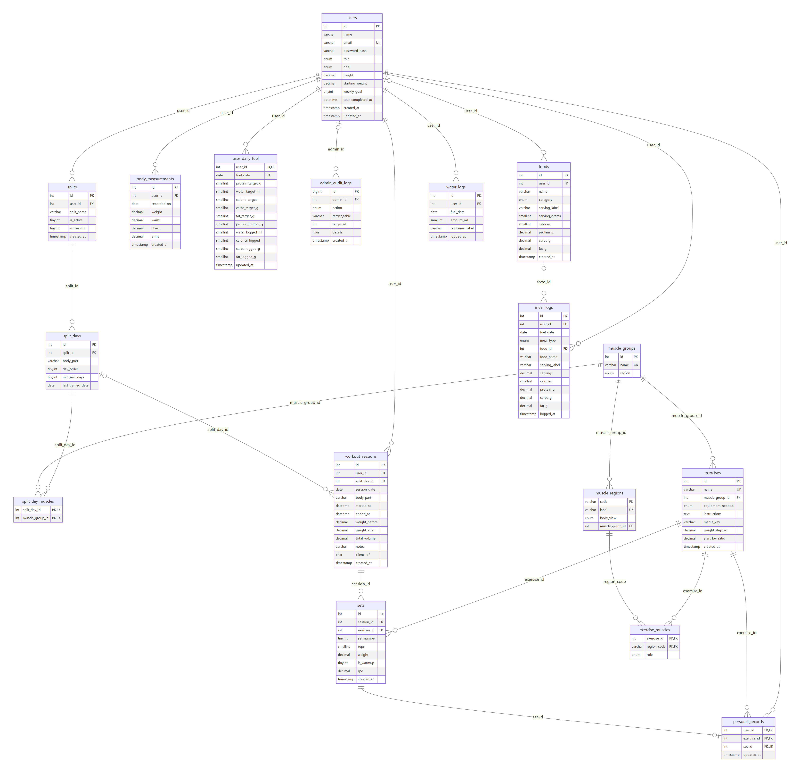

Generated from `information_schema` by `npm run docs:er`
([Mermaid source](diagrams/er-diagram.mmd), [SVG](diagrams/er-diagram.svg)). Entities, attributes, keys
and cardinalities are explained in [DATABASE_DESIGN.md §2](DATABASE_DESIGN.md#2-entity-relationship-model-mysql).

Main relationships: a **user** owns **splits** (one active at a time), each split has ordered
**split days**, and split days train **muscle groups** (M:N through `split_day_muscles`). A user logs
**workout sessions**, each with **sets** of **exercises**; **personal records** point at the best set
per user and exercise (1:0..1 with `sets`). Users also own **body measurements**, one
**user_daily_fuel** row per day, **foods**, **meal logs** and **water logs**. **Admin audit logs**
record which admin changed the exercise library. Each **exercise** works several **muscle regions**
(M:N through `exercise_muscles`, with a primary or secondary role), and each region belongs to one
**muscle group**.

## 6. Relational schema

The ER model maps to 17 relations. Primary keys are <ins>**underlined bold**</ins>, foreign keys are
*italic*. Listed straight from the live catalogue.

1. **users** (<ins>**id**</ins>, name, email, password_hash, role, goal, height, starting_weight, weekly_goal, created_at, updated_at)<br>UNIQUE (email)
2. **muscle_groups** (<ins>**id**</ins>, name, region)<br>UNIQUE (name)
3. **exercises** (<ins>**id**</ins>, name, *muscle_group_id*, equipment_needed, instructions, media_key, weight_step_kg, start_bw_ratio, created_at)<br>muscle_group_id → muscle_groups(id) ON DELETE RESTRICT · UNIQUE (name) · CHECK media_key is a lowercase slug (migration 002) · CHECK weight_step_kg IN (0, 2.5, 5, 10) and start_bw_ratio 0.01–3 (migration 003)
4. **splits** (<ins>**id**</ins>, *user_id*, split_name, is_active, active_slot, created_at)<br>user_id → users(id) ON DELETE CASCADE · UNIQUE (user_id, active_slot), where `active_slot` is a generated column, so a user has at most one active split
5. **split_days** (<ins>**id**</ins>, *split_id*, body_part, day_order, min_rest_days, last_trained_date)<br>split_id → splits(id) ON DELETE CASCADE · UNIQUE (split_id, body_part) · UNIQUE (split_id, day_order)
6. **split_day_muscles** (*<ins>**split_day_id**</ins>*, *<ins>**muscle_group_id**</ins>*)<br>split_day_id → split_days(id) ON DELETE CASCADE · muscle_group_id → muscle_groups(id) ON DELETE RESTRICT
7. **workout_sessions** (<ins>**id**</ins>, *user_id*, *split_day_id*, session_date, body_part, started_at, ended_at, total_volume, notes, client_ref, created_at)<br>user_id → users(id) ON DELETE CASCADE · split_day_id → split_days(id) ON DELETE SET NULL · UNIQUE (user_id, client_ref)
8. **sets** (<ins>**id**</ins>, *session_id*, *exercise_id*, set_number, reps, weight, is_warmup, rpe, created_at)<br>session_id → workout_sessions(id) ON DELETE CASCADE · exercise_id → exercises(id) ON DELETE RESTRICT · UNIQUE (session_id, exercise_id, set_number)
9. **personal_records** (*<ins>**user_id**</ins>*, *<ins>**exercise_id**</ins>*, *set_id*, updated_at)<br>user_id → users(id) ON DELETE CASCADE · exercise_id → exercises(id) ON DELETE RESTRICT · set_id → sets(id) ON DELETE CASCADE · UNIQUE (set_id)
10. **body_measurements** (<ins>**id**</ins>, *user_id*, recorded_on, weight, waist, chest, arms, created_at)<br>user_id → users(id) ON DELETE CASCADE · UNIQUE (user_id, recorded_on)
11. **user_daily_fuel** (*<ins>**user_id**</ins>*, <ins>**fuel_date**</ins>, protein_target_g, water_target_ml, calorie_target, carbs_target_g, fat_target_g, protein_logged_g, water_logged_ml, calories_logged, carbs_logged_g, fat_logged_g, updated_at)<br>user_id → users(id) ON DELETE CASCADE
12. **admin_audit_logs** (<ins>**id**</ins>, *admin_id*, action, target_table, target_id, details, created_at)<br>admin_id → users(id) ON DELETE SET NULL
13. **foods** (<ins>**id**</ins>, *user_id*, name, category, serving_label, serving_grams, calories, protein_g, carbs_g, fat_g, created_at)<br>user_id → users(id) ON DELETE CASCADE (NULL = built-in food)
14. **meal_logs** (<ins>**id**</ins>, *user_id*, fuel_date, meal_type, *food_id*, food_name, serving_label, servings, calories, protein_g, carbs_g, fat_g, logged_at)<br>user_id → users(id) ON DELETE CASCADE · food_id → foods(id) ON DELETE SET NULL
15. **water_logs** (<ins>**id**</ins>, *user_id*, fuel_date, amount_ml, container_label, logged_at)<br>user_id → users(id) ON DELETE CASCADE
16. **muscle_regions** (<ins>**code**</ins>, label, body_view, *muscle_group_id*)<br>muscle_group_id → muscle_groups(id) ON DELETE RESTRICT · UNIQUE (label) · CHECK code is a snake_case slug
17. **exercise_muscles** (*<ins>**exercise_id**</ins>*, *<ins>**region_code**</ins>*, role)<br>exercise_id → exercises(id) ON DELETE CASCADE · region_code → muscle_regions(code) ON DELETE RESTRICT

**Normalisation.** All relations are in 3NF; `personal_records`, `muscle_regions` and `exercise_muscles` are in BCNF. Three cached values are
derivable but kept on purpose and maintained by triggers (`split_days.last_trained_date`,
`workout_sessions.total_volume`, the `*_logged` totals in `user_daily_fuel`). The full 1NF → BCNF
analysis is in [DATABASE_DESIGN.md §3](DATABASE_DESIGN.md#3-normalisation).

## 7. Database choice and justification

| Data | Store | Why this store |
|---|---|---|
| Users, splits, workouts, sets, PRs, measurements, daily fuel, foods, meals, water, audit log | **MySQL 8** | Strongly related, structured data. A workout and its sets must be saved atomically; history must never contradict itself. Needs foreign keys, CHECK constraints, triggers, procedures, views and joins: exactly what a relational database guarantees. |
| `custom_routines` | **MongoDB** | A routine is an ordered list of exercises with targets, rest times and superset letters, always read and written as one unit. In SQL it would need extra tables and joins for something never queried by its parts. |
| `journey_stories` | **MongoDB** | Journals, notes, photos and milestones have different, sparse and changing fields (mood, energy, tags, photo angle, highlights). A table would be wide and mostly NULL and need a migration for every new field. MongoDB also gives text search and `$facet` aggregation. A JSON-schema validator still enforces the fields that matter. |
| `vector_embeddings` | **MongoDB** (vector similarity search) | One document per exercise or food holding a 32-number array. Arrays of numbers fit documents naturally, and the similarity ranking runs in an aggregation pipeline next to the data. With 72 items an exhaustive, exact search is instant, so a separate vector database was not needed. The MySQL row stays the source of truth. |

MySQL is the system of record. MongoDB documents store MySQL ids (`user_id`, `session_id`,
`exercise_id`, `entity_id`); since no database can enforce a foreign key across two stores, the API
checks those ids in MySQL before writing, and account deletion cleans both stores.

## 8. Data dictionary / schema description

- **MySQL:** every table, column, type, key, default and comment is listed in
  [DATA_DICTIONARY.md](DATA_DICTIONARY.md), generated from the live database with `npm run docs:dictionary`.
- **MongoDB:** the three collections are described below; their validators are in
  [`database/mongodb/`](../database/mongodb).

| Collection | Document (main fields) | Validator highlights | Indexes |
|---|---|---|---|
| `custom_routines` | `user_id`, `name`, `focus`, `exercises[]` {`exercise_id`, `name`, `target_sets`, `rep_min`, `rep_max`, `rest_seconds`, `superset`}, `times_used`, `last_used_at` | 1–20 exercises, `target_sets` 1–10 | unique (`user_id`, `name`); (`user_id`, `last_used_at`) |
| `journey_stories` | `user_id`, `date`, `kind`, `session_id`, `caption`, `mood`, `energy`, `tags[]`, `photo_file`, `photo_angle`, `milestone`, `weight_snapshot`, `highlights[]` | `kind` ∈ {workout_journal, progress_photo, milestone, note}, `date` `YYYY-MM-DD`, mood and energy 1–5, ≤ 12 tags | (`user_id`, `date`, `_id`) timeline; (`user_id`, `kind`, `date`); multikey (`user_id`, `tags`); sparse `session_id`; **text** on `caption` + `tags` |
| `vector_embeddings` | `domain` (exercise / food), `entity_id`, `user_id`, `title`, `subtitle`, `semantic_text`, `dimensions`, `embedding[32]`, `metadata`, `updated_at` | `domain` enum, `embedding` exactly 32 numbers | unique (`domain`, `entity_id`); (`domain`, `user_id`) |

Example documents (from the demo data):

```js
// custom_routines
{ name: 'Heavy Push', focus: 'Push', times_used: 6, exercises: [
    { exercise_id: 1, name: 'Barbell Bench Press', target_sets: 3, rep_min: 6, rep_max: 10, rest_seconds: 180, superset: null },
    { exercise_id: 17, name: 'Dumbbell Lateral Raise', target_sets: 3, rep_min: 10, rep_max: 15, rest_seconds: 60, superset: 'A' }, ... ] }

// journey_stories
{ user_id: 2, date: '2026-11-02', kind: 'workout_journal', session_id: 17, mood: 4,
  caption: 'Deadlift smooth; grip was the limiter. Chalk next time.', tags: ['deadlift', 'grip'], ... }

// vector_embeddings (first 6 of 32 numbers)
{ domain: 'exercise', entity_id: 1, user_id: null, title: 'Barbell Bench Press', dimensions: 32,
  semantic_text: 'Barbell Bench Press. Muscle group: Chest. Equipment: Barbell. ...',
  embedding: [0.262412, 0.087471, 0.174941, 0.087471, 0, 0, ...], metadata: { muscle_group: 'Chest', ... } }
```

## 9. SQL / NoSQL / vector database implementation

### 9.1 SQL: DDL

| Statement | Where | Count |
|---|---|---|
| `CREATE TABLE` with primary keys, foreign keys (with `ON DELETE` rules), `UNIQUE`, `CHECK`, generated column | [`database/schema.sql`](../database/schema.sql), [`migrations/001_nutrition_tracking.sql`](../database/migrations/001_nutrition_tracking.sql), [`migrations/003_exercise_knowledge.sql`](../database/migrations/003_exercise_knowledge.sql), [`migrations/004_weigh_in_and_tour.sql`](../database/migrations/004_weigh_in_and_tour.sql) | 17 tables, 22 FKs, 35 CHECKs |
| `ALTER TABLE`: schema evolution. 001 adds calorie and macro columns with `AFTER`, CHECK constraints and a table comment; 002 adds `exercises.media_key` with a `REGEXP_LIKE` CHECK; 003 adds `exercises.weight_step_kg` and `start_bw_ratio` with two CHECKs | [`migrations/001_nutrition_tracking.sql`](../database/migrations/001_nutrition_tracking.sql), [`migrations/002_exercise_media.sql`](../database/migrations/002_exercise_media.sql), [`migrations/003_exercise_knowledge.sql`](../database/migrations/003_exercise_knowledge.sql) | 4 statements |
| `CREATE INDEX` (composite) | [`database/indexes.sql`](../database/indexes.sql) | measured with `EXPLAIN` (§13) |
| `CREATE OR REPLACE VIEW` | [`database/views.sql`](../database/views.sql) | 7 views |
| `CREATE PROCEDURE` / `FUNCTION` / `TRIGGER` | `procedures.sql`, `triggers.sql` | 15 + 8 + 15 |
| `DROP … IF EXISTS` (procedures, functions, triggers, views); `DROP DATABASE` on a reset | same files, `scripts/init-db.js` | 39 |
| `CREATE ROLE`, `GRANT` (least privilege) | [`database/roles.sql`](../database/roles.sql) | 2 roles |

The schema is built in this order: `schema.sql` (base design, 12 tables) → `migrations/001` (3 tables
plus an `ALTER TABLE`) → `migrations/002` (`ALTER TABLE exercises`) → `migrations/003` (2 tables plus
`ALTER TABLE exercises`) → procedures → triggers → views → indexes → roles → seeds.

```sql
-- migrations/001_nutrition_tracking.sql
ALTER TABLE user_daily_fuel
    ADD COLUMN carbs_target_g  SMALLINT UNSIGNED NOT NULL DEFAULT 250 AFTER calorie_target,
    ADD COLUMN fat_target_g    SMALLINT UNSIGNED NOT NULL DEFAULT 70  AFTER carbs_target_g,
    ADD COLUMN calories_logged SMALLINT UNSIGNED NOT NULL DEFAULT 0   AFTER water_logged_ml,
    ADD COLUMN carbs_logged_g  SMALLINT UNSIGNED NOT NULL DEFAULT 0   AFTER calories_logged,
    ADD COLUMN fat_logged_g    SMALLINT UNSIGNED NOT NULL DEFAULT 0   AFTER carbs_logged_g,
    ADD CONSTRAINT chk_fuel_calories CHECK (calories_logged <= 15000),
    ADD CONSTRAINT chk_fuel_carbs    CHECK (carbs_logged_g  <= 2000),
    ADD CONSTRAINT chk_fuel_fat      CHECK (fat_logged_g    <= 1000);
```

### 9.2 SQL: DML in the application

| Operation | Examples |
|---|---|
| `INSERT` | register (`users`), save a workout (`workout_sessions` + `sets` in one transaction), log a meal or water (through `sp_log_meal`, `sp_log_water`), add a custom food, add a measurement |
| `UPDATE` | edit a saved set, change profile and goal, switch split (deactivate old, carry over recovery), admin edits an exercise |
| `DELETE` | delete a workout (triggers roll back PRs and recovery), remove a set, a meal or a water entry, delete an account (cascades) |
| `SELECT` | dashboards, history with keyset paging, progress charts, views, the recommendation |

Joins, `GROUP BY`, `HAVING`, `ORDER BY`, aggregates (`COUNT`, `SUM`, `AVG`, `MAX`), subqueries
(scalar, correlated, anti-join), CTEs (including `WITH RECURSIVE`) and window functions are used; §10
lists the important ones.

### 9.3 Advanced database features (requirement §7: all eight are used)

| Feature | Implementation |
|---|---|
| **Transactions** | A workout is one transaction (session + all sets); editing locks the session row (`SELECT … FOR UPDATE`); switching splits is one transaction; idempotent retry via `UNIQUE (user_id, client_ref)`. `src/lib/mysql.ts` → `withTransaction` |
| **Views** | `view_split_day_status` (recovery status and priority rank), `view_personal_records_detailed`, `view_weekly_summary`, `view_weekly_muscle_volume`, `view_exercise_session_best`, `view_daily_nutrition_summary`, `view_hydration_daily` |
| **Stored procedures / functions** | `sp_get_next_body_part` (scheduler), `sp_estimate_next_target` (overload), `sp_rebuild_personal_records` (window function), `sp_rep_max_table` (recursive CTE), `sp_get_daily_fuel`, `sp_log_meal`, `sp_log_water`, `sp_schema_stats` (`SQL SECURITY DEFINER`), `fn_calculate_1rm`, `fn_calorie_target`, `fn_starting_weight` (a first-timer's weight from body weight), … |
| **Triggers** | 15: validation with `SIGNAL`, session volume, last-trained date, PR detection and rollback, daily fuel totals from meals and water, admin audit trail |
| **Indexing** | Composite indexes in MySQL (7 vs 60,019 rows examined, §13); compound, multikey, sparse and text indexes in MongoDB |
| **Full-text search** | MongoDB text index on journal captions and tags, ranked by relevance |
| **NoSQL aggregation** | `$facet` (stories per kind, mood per week, top tags in one round trip), `$group` + `$match` (HAVING), `$dateTrunc`, `$unwind` |
| **Vector similarity search** | Cosine similarity over 32-number vectors in a MongoDB aggregation pipeline (§9.6) |

### 9.4 Data validation and integrity at the database level (requirement §12)

- **Declarative:** `NOT NULL`, `UNIQUE`, 35 `CHECK` constraints (e.g. reps 1–100, weight 0–999.99, weekly goal 1–7,
  height 100–250 cm, water 50–5000 ml, weight step 0 / 2.5 / 5 / 10 kg), `ENUM`s, foreign keys with deliberate `CASCADE` / `RESTRICT` / `SET NULL` rules,
  and a generated column + unique index that allows one active split per user.
- **Procedural:** `BEFORE INSERT/UPDATE` triggers call `sp_assert_valid_session`, which `SIGNAL`s on a
  future date, a split day of another user or a session moved to another user.
- **Consistency of derived data:** triggers keep `total_volume`, `last_trained_date`, personal records
  and daily totals correct on every insert, update and delete; foreign-key cascades do not fire
  triggers, so the session-delete trigger rebuilds PRs explicitly.
- **MongoDB:** `$jsonSchema` validators with `validationLevel: strict` and `validationAction: error`.
- The API validates input as well (zod), but the database rules hold even for direct SQL.

### 9.5 NoSQL implementation

Collections, validators and indexes are created by `scripts/init-db.js` from
[`database/mongodb/*.schema.json`](../database/mongodb). All MongoDB queries are collected in
[`database/mongodb/queries.mongodb.js`](../database/mongodb/queries.mongodb.js) (runnable in `mongosh` or
Compass); `npm run viva:mongo` runs a narrated demo. Writes to MongoDB happen after the MySQL commit
and are best effort: if MongoDB is down, the workout is still saved and the API returns a warning.

### 9.6 Vector database / semantic search (requirement §8)

| Question | Answer |
|---|---|
| **What data is converted into embeddings** | Every exercise (44) and food (28 built-in plus members' custom foods). For each, a text is built from its MySQL row: name, muscle group or food category, equipment or serving and macros, and a few descriptive keywords. |
| **Which embedding approach / model** | A deterministic, offline embedding written for this project ([`src/lib/embedding-engine.js`](../src/lib/embedding-engine.js)), with no external model or API. 32 dimensions: 16 fitness concept axes (chest, pull, legs, joint-friendly, high protein, carbs, timing, …) scored from keywords, plus 16 dimensions of signed feature hashing over word stems and character trigrams. The vector is then scaled to length 1. The same text always gives the same vector. |
| **How vectors are stored** | MongoDB collection `vector_embeddings`, one document per item: `domain`, `entity_id` (the MySQL id), `user_id` (custom foods only), `embedding` (32 numbers), `semantic_text`, `metadata`. A validator enforces 32 numbers; unique index (`domain`, `entity_id`). Seeded by `db:init`; a vector is added when an exercise or custom food is created, re-embedded when an admin edits an exercise, and removed when the exercise or the member's account is deleted. |
| **Similarity metric** | Cosine similarity. Because every vector has length 1 (checked in query 13 of `queries.mongodb.js`), it equals the dot product. Euclidean (L2) distance is returned as well. |
| **How relevant results are retrieved** | The typed text is embedded the same way. An aggregation pipeline filters by `domain` and owner (`user_id` null or the member, using the (`domain`, `user_id`) index), computes the similarity for every candidate with `$reduce`, sorts by similarity and keeps the top *k*: an exact k-nearest-neighbour search. Used by Train (find exercises and alternatives) and Fuel → Log food (foods by meaning); `GET /api/vector/search`. |

### 9.7 Authentication, authorization and security (requirements §11, §13)

- Two application roles, **member** and **admin**; NextAuth sessions; passwords hashed with bcrypt.
- Every query is scoped by the user id from the session, never by an id sent by the browser.
- The app connects to MySQL as a least-privilege account holding the `physiq_app` role (row access +
  `EXECUTE`, no DDL, no `GRANT`); a `physiq_readonly` role exists for reporting. Tested in
  `tests/db/privileges.test.js`.
- Credentials and secrets come from environment variables (`.env`, git-ignored; `.env.example` lists
  the names); none are hard-coded.
- Security headers and a production Content-Security-Policy; progress photos are private files served
  only to their owner.

### 9.8 Database–application integration (requirement §10)

The Next.js pages call route handlers under `src/app/api/*`. Each handler validates the request (zod),
reads the session, then uses `src/lib/mysql.ts` (mysql2 connection pool, `withTransaction`) and
`src/lib/mongodb.ts` (driver singleton). Configuration comes only from environment variables
(`MYSQL_*`, `MONGODB_*`, `NEXTAUTH_*`).

## 10. Important queries

The SQL below is excerpted from the repository files; [`database/queries/`](../database/queries) holds more
(`demo_analytical_queries.sql`, `viva_demo.sql`, `explain_benchmark.sql`). MongoDB queries are in
[`database/mongodb/queries.mongodb.js`](../database/mongodb/queries.mongodb.js).

**Q1. Adaptive schedule: recovery status of every split day** (`views.sql`, `CASE`, window function)

```sql
CASE
    WHEN d.days_since IS NULL                    THEN 'new'
    WHEN d.days_since <  d.min_rest_days         THEN 'recovering'
    WHEN d.days_since >= d.min_rest_days + 2     THEN 'overdue'
    ELSE 'ready'
END AS status,
ROW_NUMBER() OVER (PARTITION BY d.user_id ORDER BY …) AS priority_rank
```
`sp_get_next_body_part` returns the day with `priority_rank = 1`.

**Q2. Exercises whose recent top weight beats their all-time average** (`JOIN`, `GROUP BY`, `HAVING` with a correlated subquery)

```sql
SELECT e.name AS exercise, MAX(s.weight) AS recent_top_kg
FROM sets s
JOIN workout_sessions ws ON ws.id = s.session_id
JOIN exercises e         ON e.id = s.exercise_id
WHERE ws.user_id = @u AND s.is_warmup = FALSE
  AND ws.session_date >= DATE_SUB(CURRENT_DATE, INTERVAL 14 DAY)
GROUP BY e.id, e.name
HAVING MAX(s.weight) > (
    SELECT AVG(s3.weight) FROM sets s3
    JOIN workout_sessions ws3 ON ws3.id = s3.session_id
    WHERE ws3.user_id = @u AND s3.exercise_id = e.id AND s3.is_warmup = FALSE)
ORDER BY recent_top_kg DESC;
```

**Q3. Personal records rebuilt with a window function** (`sp_rebuild_personal_records`)

```sql
ROW_NUMBER() OVER (
    PARTITION BY s.exercise_id
    ORDER BY fn_calculate_1rm(s.weight, s.reps) DESC, s.weight DESC, s.reps DESC,
             ws.session_date ASC, s.id ASC) AS rn
… WHERE ranked.rn = 1
ON DUPLICATE KEY UPDATE set_id = ranked.set_id;
```

**Q4. Training streak: gaps and islands** (`viva_demo.sql` §7b, CTE + `ROW_NUMBER`)

```sql
WITH active AS (SELECT DISTINCT week_start FROM view_weekly_summary WHERE user_id = @alex),
runs AS (SELECT week_start,
                DATEDIFF(week_start, '2000-01-03') DIV 7 - ROW_NUMBER() OVER (ORDER BY week_start) AS run_id
         FROM active)
SELECT COUNT(*) AS weeks_in_run, MIN(week_start) AS from_week, MAX(week_start) AS to_week
FROM runs GROUP BY run_id ORDER BY to_week DESC;
```

**Q5. Rep-max table with a recursive CTE** (`sp_rep_max_table`, served by `GET /api/calc/one-rep-max`)

```sql
WITH RECURSIVE n (reps) AS (SELECT 1 UNION ALL SELECT reps + 1 FROM n WHERE reps < 12)
SELECT reps, v_one_rm AS one_rm,
       CASE WHEN reps = 1 THEN v_one_rm ELSE ROUND(v_one_rm / (1 + reps / 30), 1) END AS weight_kg
FROM n ORDER BY reps;
```

**Q6. Trigger: volume and PR detection on every new set** (`triggers.sql`)

```sql
CREATE TRIGGER trg_sets_ai AFTER INSERT ON sets FOR EACH ROW
BEGIN
    DECLARE v_user_id INT;
    IF NEW.is_warmup = FALSE THEN
        UPDATE workout_sessions SET total_volume = total_volume + NEW.weight * NEW.reps
        WHERE id = NEW.session_id;
    END IF;
    SET v_user_id = (SELECT user_id FROM workout_sessions WHERE id = NEW.session_id);
    CALL sp_check_and_update_pr(v_user_id, NEW.exercise_id);
END
```

**Q7. Switching splits keeps recovery: one correlated `UPDATE`** (`POST /api/splits`, inside the transaction)

```sql
UPDATE split_days sd
SET sd.last_trained_date = (
    SELECT MAX(ws.session_date)
    FROM workout_sessions ws
    JOIN sets s ON s.session_id = ws.id AND s.is_warmup = FALSE
    JOIN exercises e ON e.id = s.exercise_id
    JOIN split_day_muscles sdm ON sdm.split_day_id = sd.id AND sdm.muscle_group_id = e.muscle_group_id
    WHERE ws.user_id = ?)
WHERE sd.split_id = ?;
```

**Q8. History with keyset pagination** (`GET /api/workouts`): `WHERE ws.user_id = ? AND (ws.session_date, ws.id) < (?, ?)` ordered by date and id, newest first,, served by `idx_workout_sessions_user_date`, so deep pages stay fast (no `OFFSET`).

**Q9. MongoDB: journey insights with `$facet`** (one round trip)

```js
db.journey_stories.aggregate([
  { $match: { user_id: ALEX } },
  { $facet: {
      perKind:    [{ $group: { _id: '$kind', stories: { $sum: 1 } } }],
      moodByWeek: [{ $match: { mood: { $ne: null } } },
                   { $addFields: { day: { $dateFromString: { dateString: '$date' } } } },
                   { $group: { _id: { $dateTrunc: { date: '$day', unit: 'week', startOfWeek: 'monday' } }, avgMood: { $avg: '$mood' } } }],
      topTags:    [{ $unwind: '$tags' }, { $group: { _id: '$tags', uses: { $sum: 1 } } }, { $sort: { uses: -1 } }, { $limit: 3 }] } },
]);
```

**Q10. MongoDB: full-text search ranked by relevance**

```js
db.journey_stories.find({ user_id: ALEX, $text: { $search: 'deadlift' } },
                        { date: 1, caption: 1, score: { $meta: 'textScore' } })
                  .sort({ score: { $meta: 'textScore' } });
```

**Q11. Vector similarity search: k nearest neighbours** (same pipeline as `src/lib/vector.ts`)

```js
db.vector_embeddings.aggregate([
  { $match: { domain: 'exercise', $or: [{ user_id: null }, { user_id: ALEX }] } },
  { $addFields: { cosine_similarity: { $reduce: {
      input: { $range: [0, 32] }, initialValue: 0,
      in: { $add: ['$$value', { $multiply: [{ $arrayElemAt: ['$embedding', '$$this'] },
                                             { $arrayElemAt: [queryVector, '$$this'] }] }] } } } } },
  { $sort: { cosine_similarity: -1 } },
  { $limit: 5 },
]);
```
For Barbell Bench Press the nearest exercises are Incline Barbell Bench Press (0.9085) and
Close-Grip Bench Press (0.9082).

**Q12. What the app knows about an exercise** (`viva_demo.sql` §13: M:N join, conditional `GROUP_CONCAT`, stored function)

```sql
SELECT e.name, e.weight_step_kg,
       fn_starting_weight(@alex, e.id) AS first_time_start_kg,
       GROUP_CONCAT(CASE WHEN em.role = 'primary'   THEN mr.label END ORDER BY mr.label SEPARATOR ', ') AS main_muscles,
       GROUP_CONCAT(CASE WHEN em.role = 'secondary' THEN mr.label END ORDER BY mr.label SEPARATOR ', ') AS helping_muscles
FROM exercises e
JOIN exercise_muscles em ON em.exercise_id = e.id
JOIN muscle_regions mr   ON mr.code = em.region_code
WHERE e.name IN ('Barbell Deadlift', 'Lat Pulldown', 'Face Pull', 'Pull-Up')
GROUP BY e.id, e.name, e.weight_step_kg
ORDER BY e.weight_step_kg DESC, e.name;
```

| name | weight_step_kg | first_time_start_kg | main_muscles | helping_muscles |
|---|---|---|---|---|
| Barbell Deadlift | 10 | 47.5 | Glutes, Hamstrings, Lower back | Lats, Quads, Traps |
| Lat Pulldown | 5 | 35 | Lats | Biceps, Rear delts |
| Face Pull | 2.5 | 15 | Rear delts | Side delts, Traps |
| Pull-Up | 0 | 0 | Lats | Biceps, Rear delts |

The guided workout reads the same rows: the red body map, the +10 / +5 / +2.5 kg jump between sets,
and the first-time weight for Alex (77.2 kg). A bodyweight exercise starts at 0 kg.

## 11. System architecture

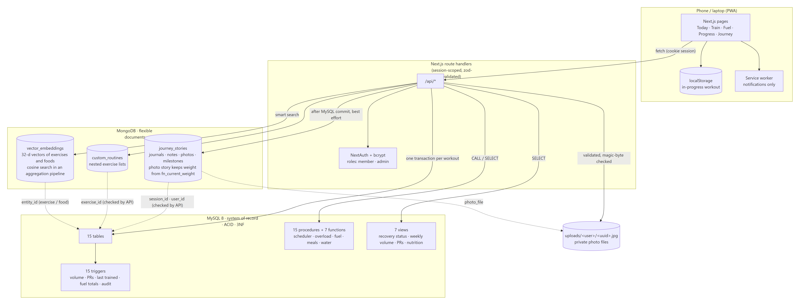

| Layer | What it does |
|---|---|
| Client (phone or laptop) | Next.js pages (Today, Train, Fuel, Progress, Journey, Profile, Admin); the workout in progress is kept on the device until it is saved |
| API (Next.js route handlers) | Authentication and roles, input validation, session scoping, transactions |
| MySQL 8 | System of record: tables, constraints, triggers, procedures, functions, views, indexes, roles |
| MongoDB | `custom_routines`, `journey_stories`, `vector_embeddings` with validators and indexes |
| File storage | Private progress photos (`uploads/<user>/<uuid>.jpg`), served only through the API |

## 12. Application screenshots

| | | |
|---|---|---|
| 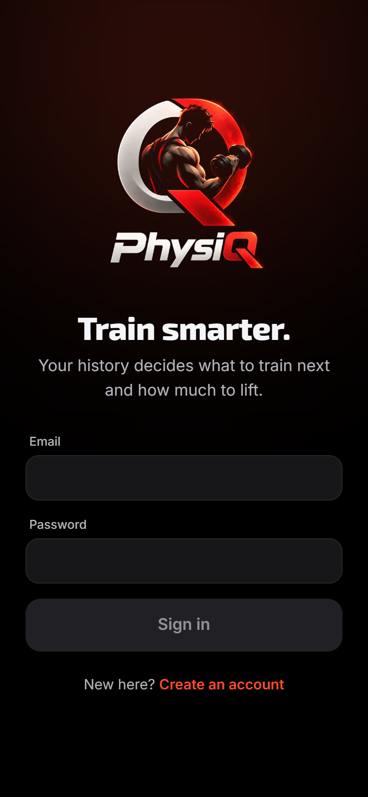 Sign in | 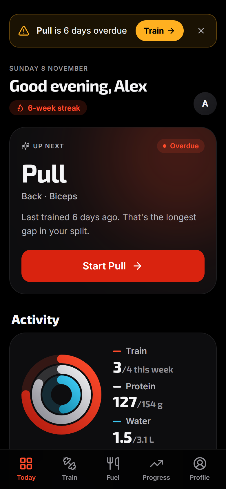 Today: Up Next and overdue alert | 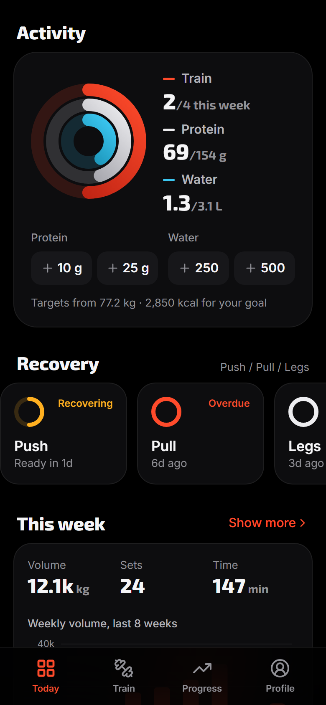 Activity rings and recovery |
| 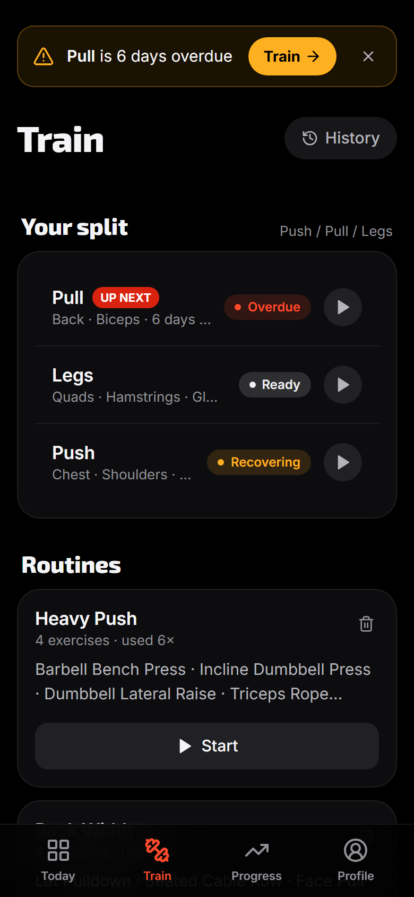 Train: split, recovery, routines | 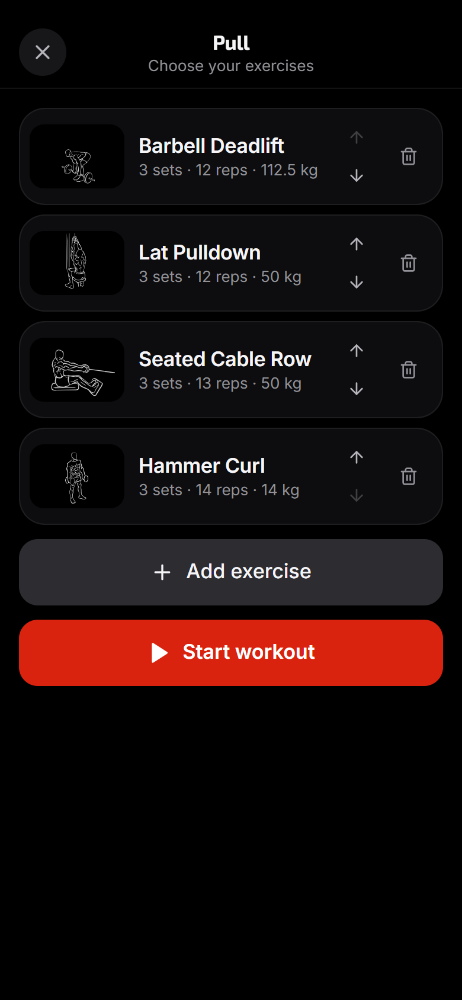 Choose and order the exercises | 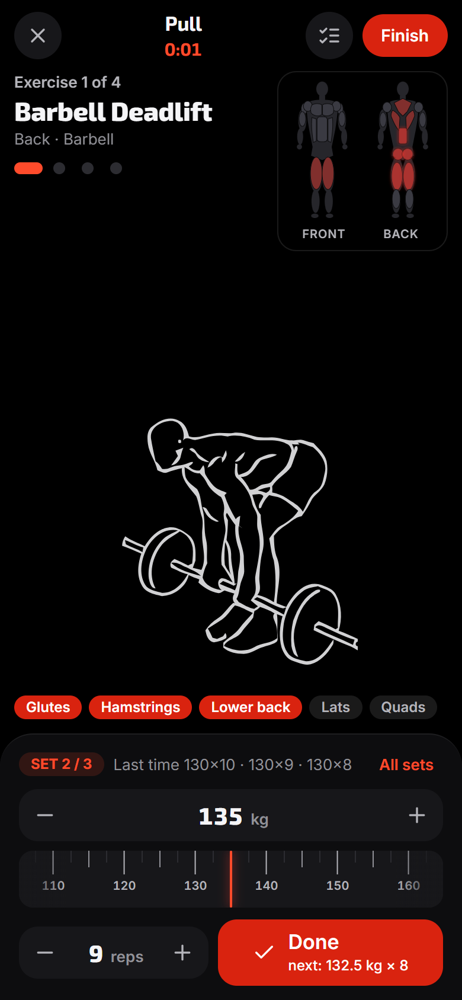 Guided workout: demonstration, muscles in red, weight ruler, Done |
| 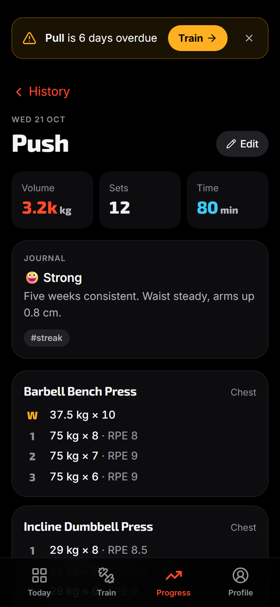 A saved workout | 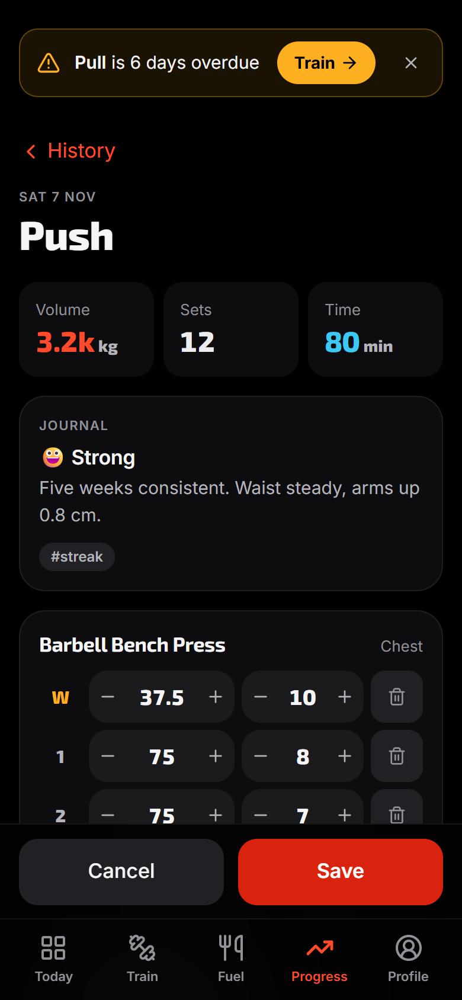 Editing a saved workout | 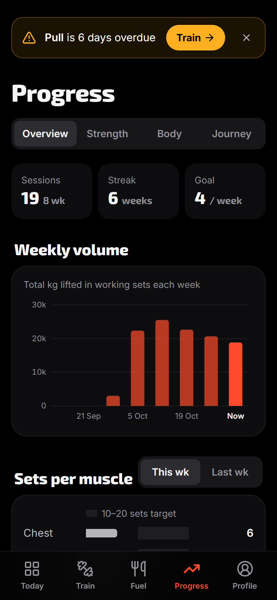 Progress overview |
| 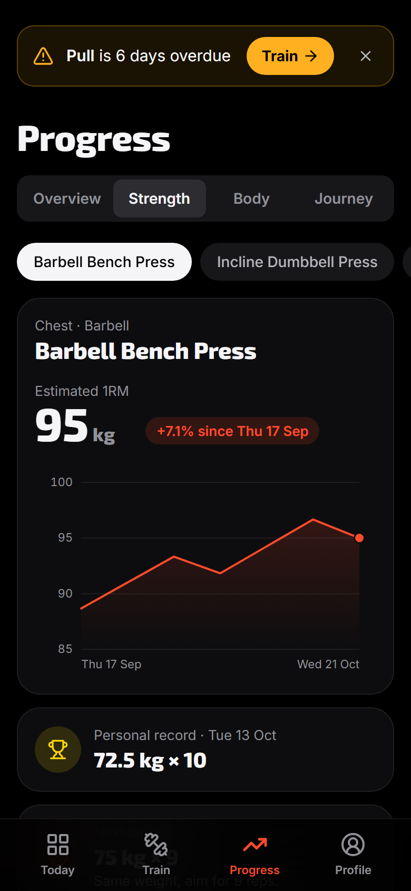 Strength trend | 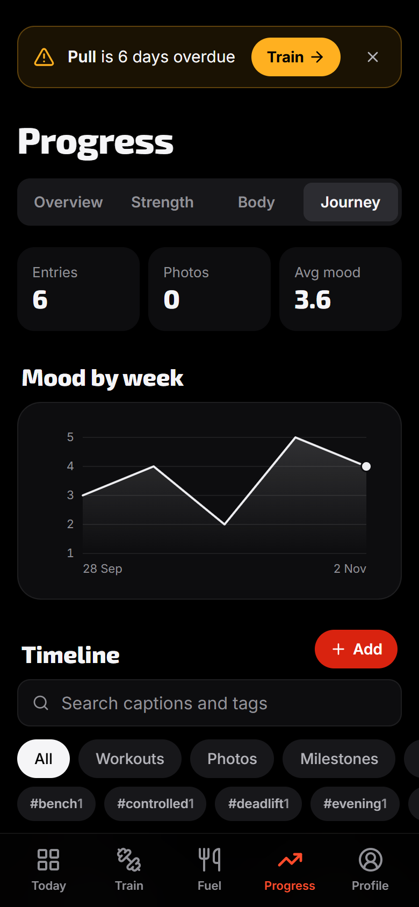 Journey (MongoDB) | 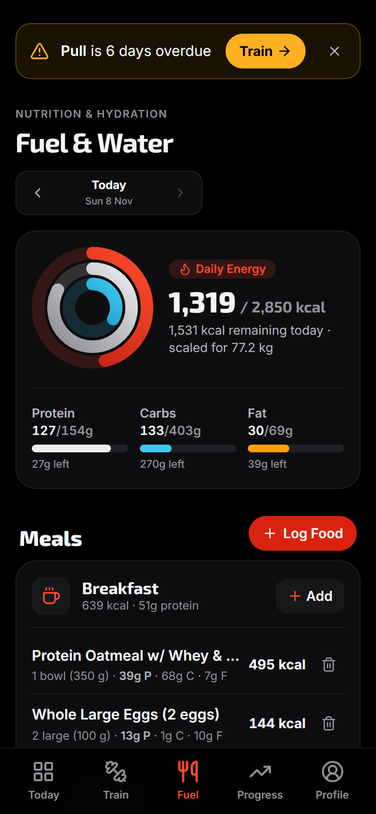 Fuel: targets, meals, water |
| 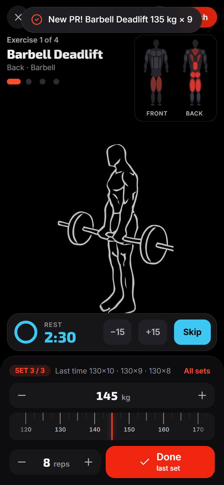 Rest timer between sets | 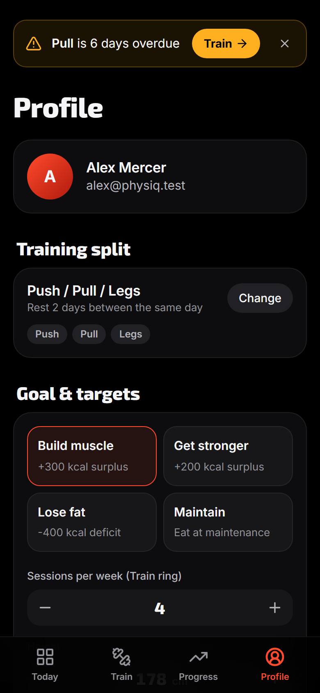 Profile | 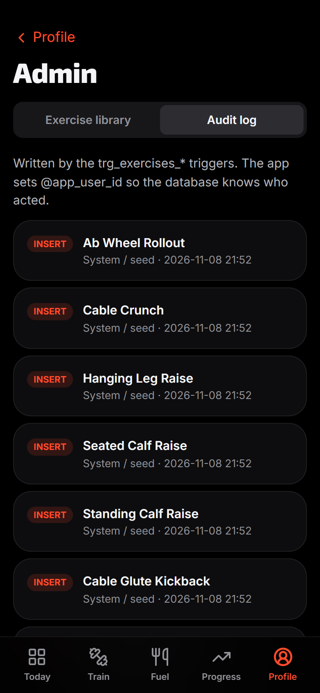 Admin: audit log |

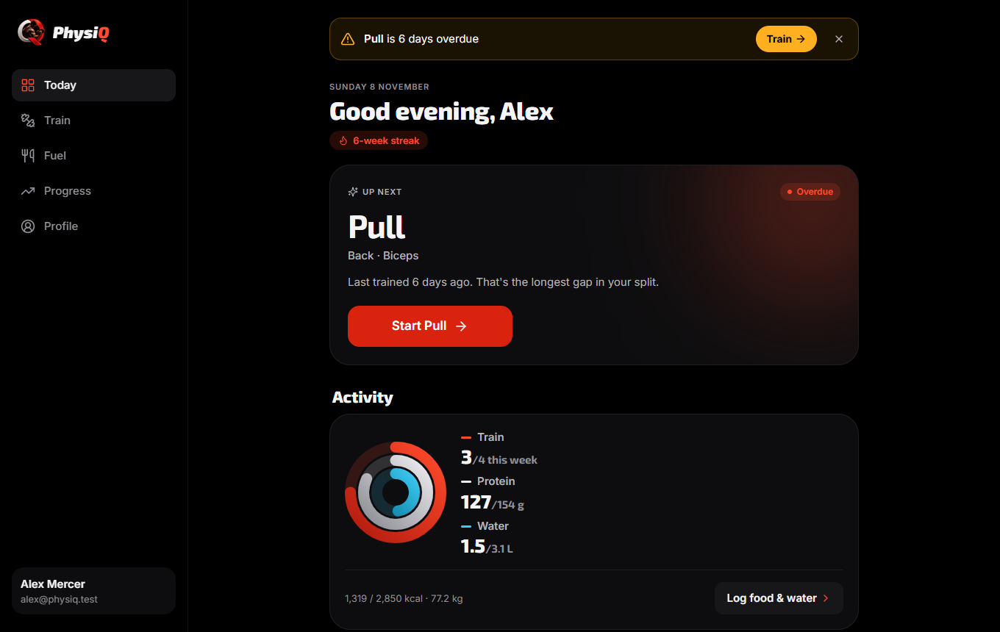
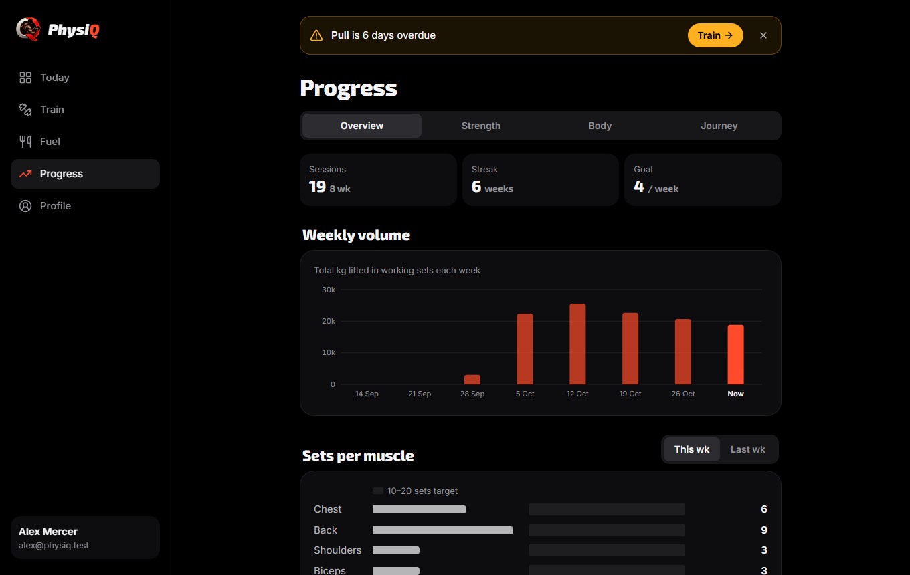

## 13. Testing results

Run on 8 November 2026 against freshly built databases (MySQL 8.0.46, MongoDB 8.2.1) and the
production build of the app; the same suites run in GitHub Actions on every push.

| Suite | Command | Tests | Result | Covers |
|---|---|---|---|---|
| Database | `npm run test:db` | 50 | **50 passed** | constraints (including the exercise media key from migration 002 and the exercise knowledge from migration 003), triggers (volume, PRs, recovery, fuel totals), procedures and functions, views, MongoDB validators and indexes, least-privilege account; each test runs in a rolled-back transaction |
| API | `npm run test:api` | 39 | **39 passed** | authentication and roles, workout save / retry / rollback / edit / delete, split switching with recovery carry-over, journey and photos, data export, account deletion across both stores, nutrition, vector search scoping and sync |
| Browser | `npm run test:e2e` | 16 | **16 passed** | a full guided workout (choose exercises, muscle map, weight ruler, Done → next set +10 kg, PR, next exercise), sign-up and onboarding, Journey, admin, and an accessibility (axe-core, WCAG 2.2 AA) and overflow audit of every screen at 320, 390 and 1280 px |

**Index performance** ([QUERY_PERFORMANCE_EXPLAIN.md](QUERY_PERFORMANCE_EXPLAIN.md)), on 60,019 workout rows:

| | With the composite index | Without it |
|---|---|---|
| Rows examined | **7** | **60,019** |
| Actual time | **0.07 ms** | **27.5 ms** |

In MongoDB the journey timeline uses `IXSCAN (idx_user_timeline)` and reads 5 documents to return 5,
and the vector pre-filter uses `IXSCAN (idx_domain_user)`.

**Continuous integration:** `.github/workflows/ci.yml` audits runtime dependencies, type-checks,
builds both databases from the repository files on a clean machine, runs the database tests, builds
the app, then runs the API and browser tests against the production build.

## 14. Conclusion and future enhancements

**Conclusion.** PhysiQ goes well beyond CRUD: the database itself decides what to train next, how
much to lift, which sets are records and how much to eat, through views, procedures, functions and
triggers that hold even when data is written outside the app. MySQL carries the relational,
transactional core; MongoDB carries the documents that do not fit tables and the vectors behind smart
search, and each choice is justified by the shape of the data. The design is documented (ER
diagram, relational schema, data dictionary), the important queries are runnable, and 107 automated
tests plus `EXPLAIN` measurements back the claims.

**Future enhancements**

1. Reminders through push notifications (Web Push with stored subscriptions) for overdue days.
2. Email verification and password reset.
3. A learned embedding model (or MongoDB Atlas Vector Search / pgvector) once the library grows
   beyond what an exact search can handle.
4. Coach / gym roles that assign programmes to several members.
5. Replication, scheduled backups and object storage for photos.
6. Wearable and heart-rate imports to refine recovery.

---

**Third-party content.** Exercise demonstration drawings: everkinetic
(https://github.com/everkinetic/data), CC BY-SA 4.0, used unmodified (see `public/exercises/CREDITS.txt`).

## Appendix A: requirement checklist

| § | Requirement | Where it is met |
|---|---|---|
| 1 | Unique, real-world, not CRUD | §1; adaptive scheduling and overload computed in the database |
| 2 | 2-member team, both on database and application | Appendix B, [CONTRIBUTIONS.md](CONTRIBUTIONS.md) |
| 3 | SQL (mandatory) + NoSQL; two or more paradigms | MySQL 8 + MongoDB (documents and vectors), §7 |
| 4 | ER diagram → relational schema; entities, attributes, PKs, FKs, relationships, constraints; NoSQL/vector data model, indexes, embeddings, metadata, retrieval | §5, §6, §8, §9.6, [DATA_DICTIONARY.md](DATA_DICTIONARY.md) |
| 5 | DDL: CREATE, ALTER, DROP, keys, constraints, indexes, views | §9.1 |
| 6 | DML: INSERT, UPDATE, DELETE, SELECT; JOIN, GROUP BY, HAVING, ORDER BY, aggregates, subqueries | §9.2, §10 |
| 7 | At least four advanced features | All eight, §9.3 |
| 8 | Vector embeddings and similarity search, explained | §9.6, §10 Q11 |
| 9 | Next.js web interface: forms, tables, search, filtering, dashboards | §12 |
| 10 | Backend/API layer; no hard-coded credentials; environment variables | §9.8, `.env.example` |
| 11 | Authentication; at least two roles | member and admin, §9.7 |
| 12 | Validation at the database level; consistency and integrity | §9.4 |
| 13 | Security practices; no plain-text passwords or credentials | §9.7 |
| 14 | Documentation (14 items) | this report, sections 1–14 |
| 15 | Git/GitHub, individual commits, README with setup | [README.md](../README.md), Appendix B |
| 16 | Final demonstration | [VIVA_DEMO.md](VIVA_DEMO.md) (follows the §16 order) |
| 17 | Original design and implementation | written for this project; design decisions in [DATABASE_DESIGN.md](DATABASE_DESIGN.md) |
| 18 | Beyond CRUD; justified database choices | §1, §7, §9.3 |

## Appendix B: team and individual contribution

| Member | Main responsibilities (from the git history) |
|---|---|
| **Gagandeep N** (Gagan-1718) | Hardened relational core (schema rework, triggers, scheduler and overload procedures, views, indexes with EXPLAIN proof, roles and least privilege), authentication and roles, workout logger and guided workout with exercise demonstrations, dashboards, Journey on MongoDB, database / API / browser tests, CI, documentation |
| **Dhruvanth** (theDEMIGOD600) | Original schema, MongoDB model, Next.js scaffold and project plan; nutrition module (foods, meal and water logs, their procedures, triggers, views, API and UI); vector similarity search (embedding engine, `vector_embeddings`, search API and UI); metric / imperial input, freestyle workouts |

Both members worked on the database and the application. Commit counts, line counts per area and the method are in
[CONTRIBUTIONS.md](CONTRIBUTIONS.md) (generated from git with `npm run docs:contributions`).
